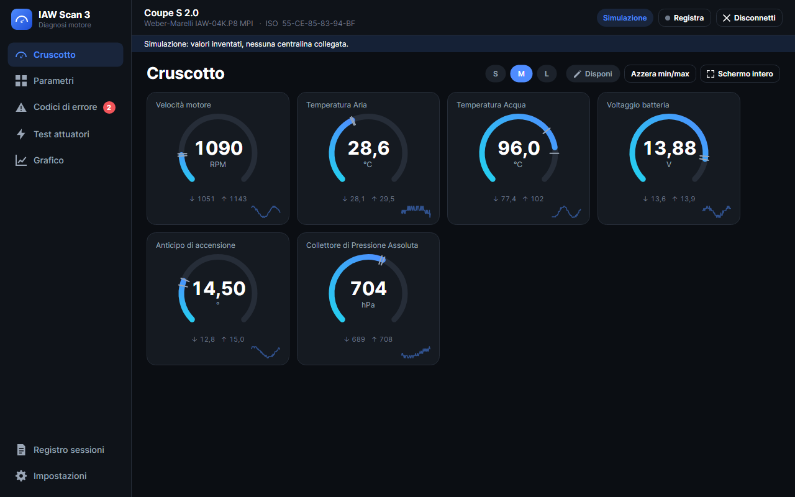
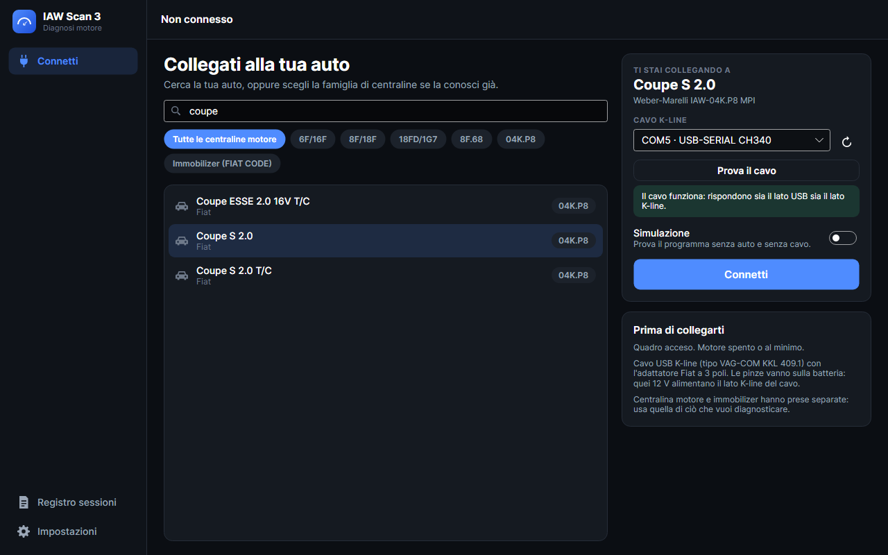
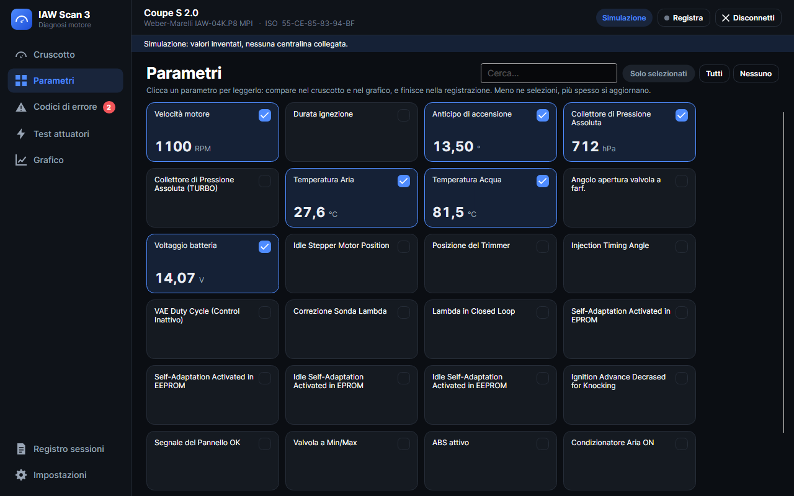
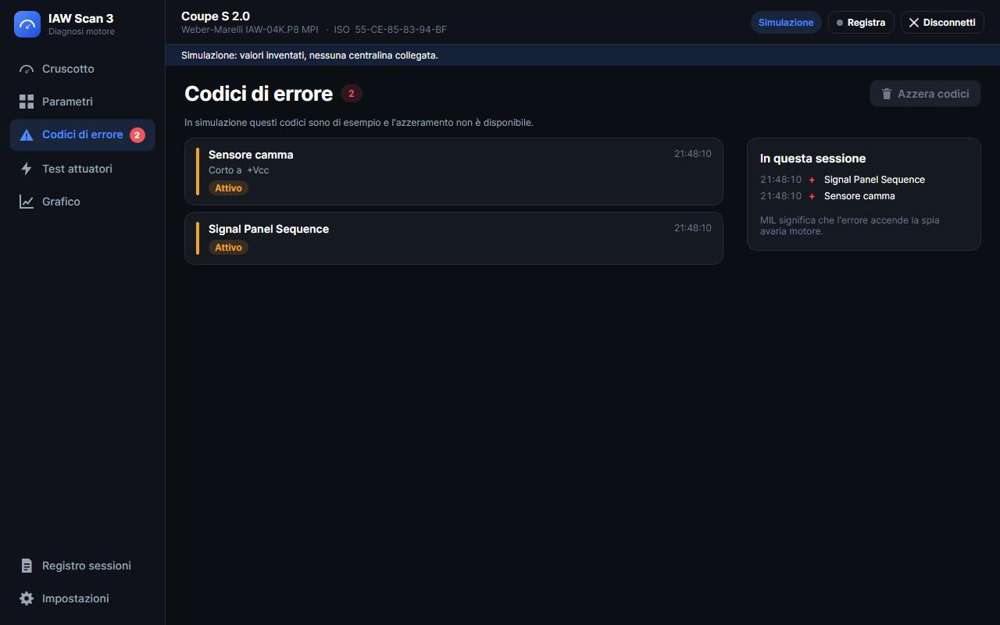
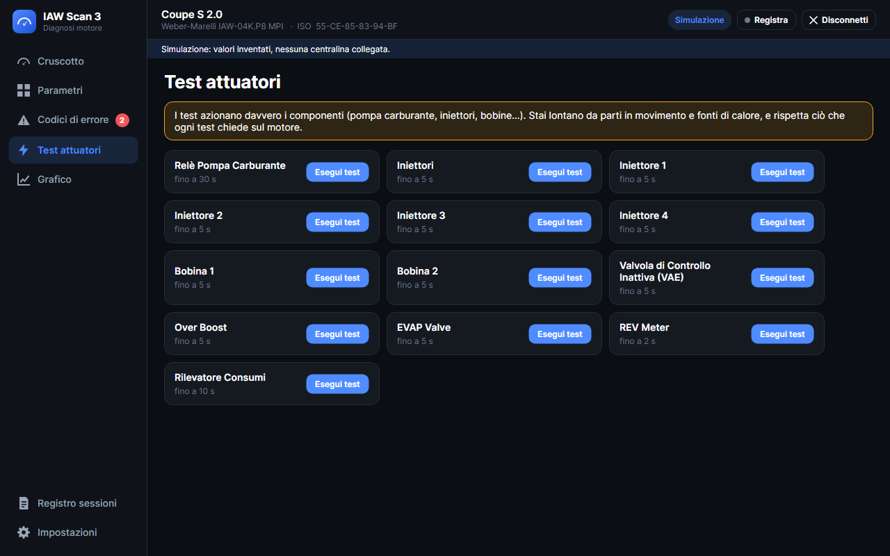
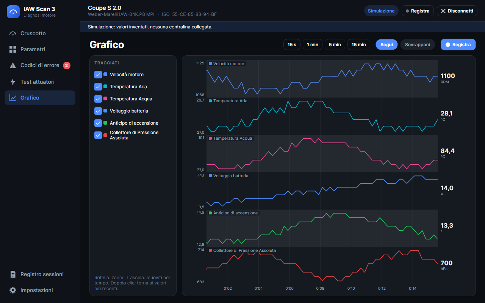
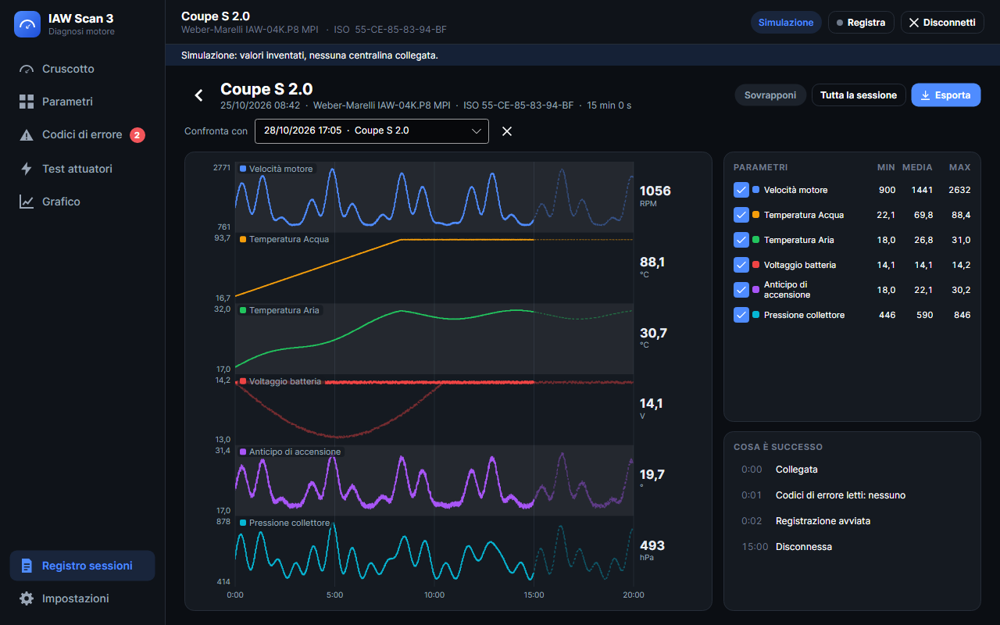
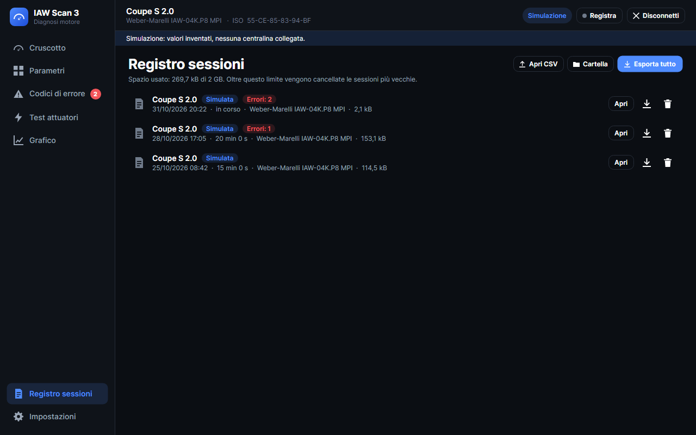
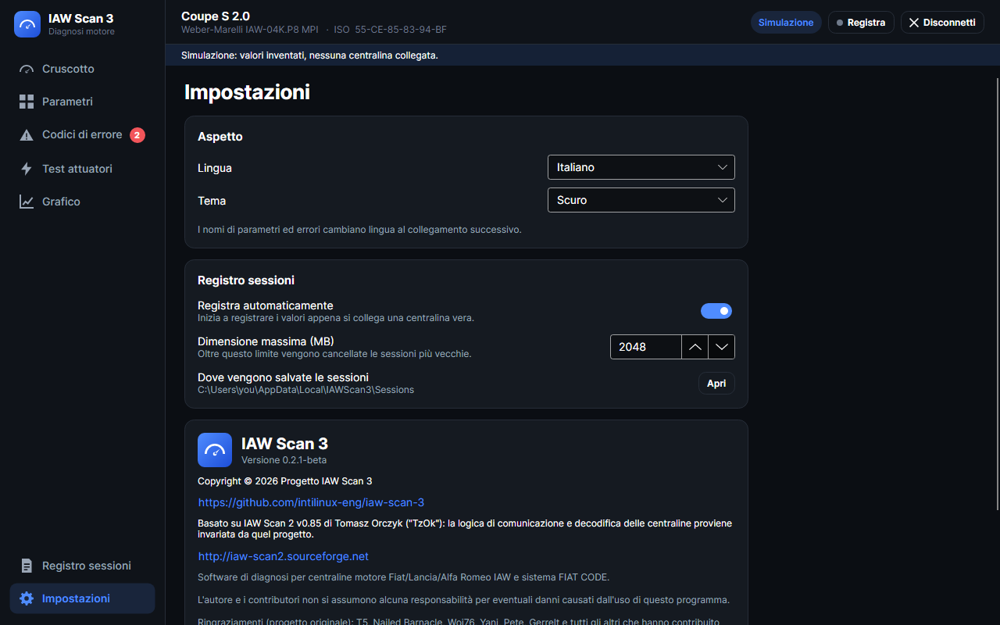

<p align="center">
  
</p>

<h1 align="center">IAW Scan 3</h1>

<p align="center">
  <strong>Diagnosi e registrazione dati per i motori Fiat, Lancia e Alfa Romeo anni '90</strong><br>
  Centraline motore Marelli IAW e immobilizer FIAT CODE, con un cavo K-line. Un fork di IAW Scan 2 di Tomasz Orczyk.
</p>

<p align="center">
  <a href="https://github.com/intilinux-eng/iaw-scan-3/releases/download/v0.2.1-beta/IAWScan3-0.2.1-beta-win-x64.exe"></a>
  &nbsp;
  <a href="https://github.com/intilinux-eng/iaw-scan-3/releases/download/v0.2.1-beta/iaw-scan3_0.2.1-beta_amd64.deb"></a>
</p>

<p align="center">
  Versione 0.2.1-beta ·
  <a href="https://github.com/intilinux-eng/iaw-scan-3/releases/latest">Tutti i download e le note di rilascio</a> ·
  <a href="#installare-lapp-desktop">Installa</a> ·
  <a href="docs/desktop/guida-utente.md">Guida utente</a> ·
  <a href="#cosa-cambia-rispetto-alloriginale-iaw-scan-2">Novità</a> ·
  <a href="README.md">English</a>
</p>



> **Beta, fornita senza alcuna garanzia e a tuo rischio**, nemmeno sul corretto funzionamento della diagnosi. Vedi [fin dove è stata provata](#fin-dove-è-stata-provata).

## Cosa fa

- **Legge il motore dal vivo:** lancette, tutti i parametri che la centralina riporta, un grafico con una corsia e una scala per ciascuno.
- **Legge e azzera i codici di errore,** dice quando sono comparsi e scomparsi, ed esegue **test attuatori** e **regolazioni**.
- **Tiene un registro di ogni sessione,** che puoi riaprire, confrontare ed esportare in uno ZIP pronto da studiare o da dare a un assistente AI.
- **Decodifica i valori esattamente come il programma originale.** Le formule sono invariate, e un test automatico fallisce se dovessero mai cambiare.

## Due modi di usarlo

| | **App desktop** | **Unità in auto, usata dal telefono** |
|---|---|---|
| **Cos'è** | Un normale programma sul computer | Una piccola scheda lasciata in auto, con il suo Wi-Fi: apri una pagina sul telefono, senza app |
| **Ideale per** | Diagnosticare un'auto con il portatile, a casa o in officina | Un registratore fisso: registra ogni viaggio da solo, e lo controlli quando vuoi |
| **Auto** | [Tutte quelle supportate](#veicoli-e-centraline-supportati) | Solo Fiat Coupé (IAW-04K.P8 e FIAT CODE) |
| **Gira su** | Windows 10/11 (64 bit), Linux (64 bit) | Arduino UNO Q |
| **Interfaccia** | Nativa, in inglese e italiano | Web, nel browser del telefono, in italiano |
| **Ti serve** | Il cavo K-line | Il cavo K-line, la scheda, un hub USB-C, il collegamento all'auto |
| **Stato** | Beta | Sperimentale: mai eseguita su hardware reale |
| **Per iniziare** | [Installa l'app desktop](#installare-lapp-desktop) | [Unità in auto](#lunità-in-auto-sperimentale) |

**Non sai quale scegliere? Inizia dall'app desktop:** copre tutte le auto, e puoi provarla subito senza auto e senza cavo.

## Installare l'app desktop

### Windows

1. Scarica **[`IAWScan3-0.2.1-beta-win-x64.exe`](https://github.com/intilinux-eng/iaw-scan-3/releases/download/v0.2.1-beta/IAWScan3-0.2.1-beta-win-x64.exe)**.
2. Avvialo. Non c'è niente da installare e .NET è incluso. Windows può avvisare che il file viene da un editore sconosciuto, perché non è firmato: clicca **Ulteriori informazioni**, poi **Esegui comunque**.
3. Collega il cavo K-line. **Non c'è niente da installare:** la prima volta, Windows 11 scarica da solo il driver da internet. Poi il cavo compare nell'elenco del programma. [Come controllarlo](docs/desktop/guida-utente.md#controllare-il-cavo-su-windows-11).

### Linux (Debian, Ubuntu e derivate, 64 bit)

1. Scarica **[`iaw-scan3_0.2.1-beta_amd64.deb`](https://github.com/intilinux-eng/iaw-scan-3/releases/download/v0.2.1-beta/iaw-scan3_0.2.1-beta_amd64.deb)**.
2. Dalla cartella in cui l'hai scaricato, installalo con `apt`, che scarica anche le librerie necessarie:
   ```
   sudo apt install ./iaw-scan3_0.2.1-beta_amd64.deb
   ```
3. Autorizza il tuo utente a usare il cavo, poi **esci e rientra nella sessione**:
   ```
   sudo usermod -aG dialout $USER
   ```
4. Avvia **IAW Scan 3** dal menu delle applicazioni, oppure con `iaw-scan3`.

Per rimuoverlo: `sudo apt remove iaw-scan3`. Le tue sessioni restano in `~/.local/share/IAWScan3` finché non le cancelli.

### Provalo subito, senza auto

Nella pagina **Connetti**, scegli un'auto, attiva **Simulazione** e clicca **Connetti**. I valori sono inventati, ma tutte le schermate funzionano.

### Collegarsi all'auto

Ti servono:

1. **Un cavo USB K-line:** il classico tipo **VAG-COM KKL 409.1**. [Tutto sul cavo](#il-cavo). Gli scanner ELM327 con queste auto **non** funzionano.
2. **Un adattatore Fiat da 3 poli a OBD-II 16 poli:** queste auto hanno una presa diagnostica triangolare a 3 poli, di solito nel vano motore vicino alla paratia o al duomo, oppure sotto il cassetto portaoggetti per l'immobilizer FIAT CODE. Le pinze dell'adattatore vanno sulla batteria: quella presa non ha i 12 V, e al cavo servono.

Poi, con il quadro acceso: cerca la tua auto nell'elenco, controlla il cavo e clicca **Connetti**. **Prova il cavo** lo controlla prima, anche senza auto. La [guida utente](docs/desktop/guida-utente.md) spiega ogni schermata.

## Il cavo


Questo è il cavo con cui il progetto viene provato:

| | |
|---|---|
| **Cavo** | Da USB a OBD-II, con l'etichetta **KKL VAG-COM for 409.1** |
| **Chip USB** | **CH340** (ID USB `1A86:7523`) |
| **Su Windows 11** | Niente da installare: la prima volta che lo colleghi, Windows scarica da solo il driver da internet. Poi compare come `USB-SERIAL CH340 (COM5)` |
| **Adattatore** | Da Fiat 3 poli a OBD-II 16 poli, con le pinze per la batteria |

Il programma non dipende dal chip, quindi i cavi con chip FTDI, l'altro tipo diffuso, dovrebbero funzionare allo stesso modo. Qualunque sia il tuo, **Prova il cavo** ti dice a che punto sei.

<br clear="right">

### Le pinze a 12 V servono

Il cavo ha due lati. Il lato USB è alimentato dal computer, per questo la porta compare anche a pinze staccate. Il lato K-line, quello che parla con la centralina, è alimentato dai 12 V delle pinze, e la presa Fiat a 3 poli non li fornisce.

Puoi verificarlo senza auto. Trasmissione e ricezione condividono un solo filo, quindi un lato K-line che funziona rimanda indietro ogni byte che invia. Misurato su questo cavo, 8 byte ciascuno a 1200, 7680 e 9600 baud:

| 12 V | Byte tornati indietro | Andata e ritorno a 7680 baud |
|---|---|---|
| Spenti | 0 su 24 | - |
| Accesi | **24 su 24**, tutti esatti | 3,4 ms |

### Come lo gestisce il programma

- **Trovarlo.** L'elenco delle porte si aggiorna da solo ogni 2 secondi e dice cos'è ciascuna: `COM5 · USB-SERIAL CH340`. I cavi vengono per primi, e quello usato l'ultima volta viene ricordato.
- **Provarlo.** **Prova il cavo** funziona senza auto: invia 3 byte a 1200 baud e 6 a 7680, le due velocità usate dalle centraline, e si aspetta che tornino tutti. Poi dice se il cavo funziona, se sembrano mancare i 12 V, o se la linea non è pulita.
- **Se Windows non ha il driver.** Un cavo con un chip noto, collegato ma senza un driver funzionante, viene segnalato nella pagina Connetti, con un link alla pagina del produttore del chip. I driver non sono inclusi nel programma: li fornisce già Windows Update, e la licenza di FTDI avverte che il suo driver può danneggiare i chip non originali, che i cavi economici possono usare.
- **Collegarsi.** 8 bit di dati, nessuna parità, 1 bit di stop, DTR e RTS spenti. Ascolta a 1200 baud per un massimo di 10 secondi la centralina che si annuncia, invia i byte di risveglio `0F AA CC` e prosegue a 7680 baud.
- **Se non risponde nessuno.** Controlla l'eco. Se manca, si ferma e dice che il lato K-line del cavo non risponde. Se c'è, si collega come faceva l'originale e dice che il cavo risponde ma la centralina non si è identificata, così puoi accendere il quadro e riconnetterti.
- **Leggere.** Un byte alla volta: invia la richiesta, scarta l'eco, legge la risposta aspettando fino a 300 ms, con una pausa di 4 ms prima della successiva. Due richieste di fila senza risposta significano comunicazione persa.
- **Tempi su Windows.** Durante il collegamento il programma chiede a Windows un timer da 2 ms, come faceva l'originale, così quelle pause sono davvero così brevi.
- **Su Linux.** Il driver fa parte del kernel, e il tuo utente deve essere nel gruppo `dialout`. Su Ubuntu, il pacchetto `brltty` può prendersi i cavi CH340 e far sparire la porta: in quel caso `sudo apt remove brltty`, a meno che tu non usi un display braille. Un cavo vero su Linux non è ancora stato provato.

## L'app desktop in breve

<table>
<tr>
<td width="50%"><br><sub><b>Connetti:</b> cerca la tua auto; il cavo viene trovato da solo, e si può provare senza auto</sub></td>
<td width="50%"><br><sub><b>Parametri:</b> scegli cosa leggere, con i valori dal vivo</sub></td>
</tr>
<tr>
<td><br><sub><b>Codici di errore:</b> letti di continuo, con ciò che è cambiato nella sessione</sub></td>
<td><br><sub><b>Test attuatori:</b> ciascuno chiede prima conferma</sub></td>
</tr>
<tr>
<td><br><sub><b>Grafico:</b> una corsia e una scala per parametro, zoom e letture col puntatore</sub></td>
<td><br><sub><b>Sessione registrata:</b> confrontata con un'altra (tratteggiata), cifre ed eventi</sub></td>
</tr>
<tr>
<td><br><sub><b>Registro sessioni:</b> ogni collegamento, pronto da riaprire o esportare</sub></td>
<td><br><sub><b>Impostazioni:</b> lingua, tema chiaro o scuro, registrazione, crediti</sub></td>
</tr>
</table>

## L'unità in auto (sperimentale)


Per la **Fiat Coupé**: una Arduino UNO Q resta in auto, collegata alla presa diagnostica e alimentata dal quadro. Il telefono si collega al suo Wi-Fi e apre `http://192.168.4.1`, senza app e senza internet.

- A ogni giro di chiave si collega da sola alla centralina e registra tutti i parametri, i codici di errore e gli eventi, con o senza telefono.
- È fatta per essere spenta semplicemente togliendo la corrente con il quadro.
- Prende data e ora dal telefono, e ricostruisce gli orari di ciò che ha registrato prima che ti collegassi.
- Ogni viaggio si scarica come ZIP per l'analisi.

**È stata provata solo in simulazione: non è mai stata eseguita su una UNO Q reale né collegata a un'auto.** Installarla significa preparare e cablare una scheda, quindi è per chi ha dimestichezza.

Pacchetti: [pre-release sperimentale](https://github.com/intilinux-eng/iaw-scan-3/releases/tag/coupe-experimental). Documentazione: [panoramica](docs/coupe/README.md) · [installazione sulla UNO Q](docs/coupe/installazione-uno-q.md) · [guida all'uso](docs/coupe/guida-uso.md) · [formato del registro](docs/coupe/registro-dati.md).

<br clear="right">

### Lavoro in corso: gli errori attivi sulla matrice LED

La UNO Q ha una matrice di LED integrata, quindi l'unità potrebbe mostrare gli errori attivi senza bisogno del telefono: tre lettere per ogni errore, e un punto per errore in basso. **Non è ancora realizzata, e queste sono simulazioni, non foto.** [Il progetto](docs/coupe/matrice-led.md) ha tutte le schermate e tutte le sigle.

<table>
<tr><td width="25%"><br><sub>Nessun errore attivo</sub></td><td width="25%"><br><sub>Un errore attivo</sub></td><td width="25%"><br><sub>Accende la spia motore</sub></td><td width="25%"><br><sub>Più errori, 2 secondi ciascuno</sub></td></tr>
</table>

## Cosa cambia rispetto all'originale IAW Scan 2

Questo progetto è un fork di [IAW Scan 2](http://iaw-scan2.sourceforge.net) v0.85 di Tomasz Orczyk ("TzOk"), a sua volta seguito di IAW ECU Scan. **Dell'originale conserva il motore diagnostico:** come i segnali vengono letti dalla centralina e decodificati, in `IES_3.Core`, e lo stesso modo di gestire porta seriale e connessione. Tutto il resto è nuovo.

| | **IAW Scan 2 v0.85** | **IAW Scan 3** |
|---|---|---|
| **Formule di decodifica** | Il riferimento | **Identiche**, verificate da un test automatico |
| **Gira su** | Da Windows 2000 a 7, con .NET Framework 2.0. Ultima versione: maggio 2015 | Windows 10/11 e Linux, con .NET 10 |
| **Installazione** | Richiede .NET Framework 2.0 | Un file da 32 MB su Windows, un pacchetto da 26 MB su Linux, .NET incluso |
| **Interfaccia** | Windows Forms, schede e tabelle | Nuova: barra laterale, lancette, tema scuro e chiaro |
| **Lingue dell'interfaccia** | 7 (inglese, tedesco, croato, italiano, polacco, portoghese, serbo) | Inglese e italiano per ora |
| **Trovare la centralina** | Scelta della famiglia; rilevamento automatico dal codice ISO | Cerca l'auto per nome, o scegli la famiglia. Il rilevamento automatico è stato tolto perché su hardware reale si è rivelato inaffidabile |
| **Trovare il cavo** | Un elenco di soli nomi di porte, letto una volta all'avvio: un cavo collegato dopo significa riavviare il programma. Quando la connessione fallisce, niente distingue il cavo dall'auto | L'elenco si aggiorna da solo e dice cos'è ciascuna porta (`COM5 · USB-SERIAL CH340`), con il cavo per primo. **Prova il cavo** funziona senza auto e dice se mancano i 12 V. Una connessione fallita dice se il problema è il cavo o la centralina, e un driver mancante viene segnalato |
| **Provarlo senza auto** | Un Ctrl+clic nascosto | Un interruttore nella pagina Connetti |
| **Valori dal vivo** | Una tabella | Lancette con valori minimi e massimi, storia recente, disposizione a piacere, schermo intero |
| **Parametri che condividono un byte** | Spegnerne uno congelava l'altro senza avvisare | Ciascuno continua ad aggiornarsi |
| **Grafico** | Una scala per tutto, quindi 6000 giri schiacciano 14 V; solo durante la registrazione | Una corsia e una scala per ciascuno, zoom, spostamento, letture col puntatore, sempre attivo, fino a un'ora |
| **Registrazione** | A mano, un CSV nella cartella da cui si è avviato il programma, con le altre schede bloccate nel frattempo. Un log di testo se spuntato | Ogni sessione registrata, anche in automatico, con i suoi eventi e un limite di spazio. Tutte le pagine restano utilizzabili |
| **Riesaminare dopo** | Aprire il CSV altrove | Riapri nel programma, confronta due sessioni, salta a un evento |
| **Esportare** | CSV | ZIP con dati, eventi e descrizione del formato, pronto per uno script o un assistente AI |
| **Codici di errore** | Letti nella loro scheda, o insieme ai parametri se si spunta una casella | Letti di continuo, con conteggio dal vivo e storia di ciò che è comparso e scomparso |
| **Azzeramento codici, test attuatori** | Il tasto `C` azzera subito, i test partono con un clic | Chiedono sempre conferma; nessuna scorciatoia a un tasto |
| **Mentre parla con la centralina** | La finestra smette di rispondere durante connessione e regolazioni | Continua a rispondere: tutto ciò che passa sulla seriale gira in background |
| **In auto** | No | [Unità per Fiat Coupé](#lunità-in-auto-sperimentale), usata dal telefono (sperimentale) |
| **Test automatici** | No | Sì, su Windows e Linux, compresa una centralina emulata |

La vecchia interfaccia Windows Forms non è più inclusa. Modifica per modifica, in parole semplici: [CHANGELOG.md](CHANGELOG.md) (in inglese). La storia del progetto originale: [readme.txt](readme.txt).

## Veicoli e centraline supportati

<details>
<summary><b>Mostra l'elenco completo di auto e centraline</b></summary>

### Per veicolo

#### Fiat
| Modello | Motore / Specifiche | Alimentazione | Centralina |
|---|---|---|---|
| **Cinquecento** | 899cc (0.9) SPI (ECE F2) | SPI | Magneti-Marelli IAW-6F / 16F |
| **Cinquecento Sporting** | 1108cc (1.1) FIRE SPI (ECE F2) | SPI | Magneti-Marelli IAW-6F / 16F |
| **Seicento** | 899cc (0.9) SPI (CM, F2) | SPI | Magneti-Marelli IAW-6F / 16F |
| **Panda** (141) | 899cc SPI (ECE F2) | SPI | Magneti-Marelli IAW-6F / 16F |
| **Panda** (141) | 1000cc (1.0) FIRE SPI (ECOL / ECE F2) | SPI | Magneti-Marelli IAW-6F / 16F |
| **Panda / Selecta** (141) | 1108cc (1.1) FIRE SPI CA (ECE F2) | SPI | Magneti-Marelli IAW-6F / 16F |
| **Panda 4x4** (141) | 1108cc (1.1) FIRE SPI 4x4 (ECE F2) | SPI | Magneti-Marelli IAW-6F / 16F |
| **Punto 55** (176) | 1.1 FIRE SPI (5M/6M, ECE F2 / Em.04 Est Europa) | SPI | Magneti-Marelli IAW-6F / 16F |
| **Punto 60 / Selecta** (176) | 1.2 (1242cc) FIRE SPI (CM, ECE F2 T.i.T.) | SPI | Magneti-Marelli IAW-6F / 16F |
| **Punto 75** (176) | 1.2 (1242cc) FIRE 8V MPI (ECE F2 / ECOL) | MPI | Magneti-Marelli IAW-8F / 18F |
| **Punto 85 16V** (176) | 1.2 (1242cc) FIRE 16V MPI (CEE F2) | MPI | Magneti-Marelli IAW-18FD |
| **Coupé 2.0 16V** | 2.0 16V N/A (Lampredi / Pratola Serra) | MPI | Weber-Marelli IAW-04K.P8 |
| **Coupé 2.0 16V Turbo** | 2.0 16V Turbo / Plus (T/C, ESSE) | MPI | Weber-Marelli IAW-04K.P8 |
| **Tipo** | 1.4 / 1372cc SPI (ECE 04, TOFAS) | SPI | Magneti-Marelli IAW-6F / 16F |
| **Tipo / Tempra** | 1.6 SPI (USA'83 / Em.04, TOFAS) | SPI | Magneti-Marelli IAW-6F / 16F |
| **Tipo / Tempra** | 1.8 8V MPI (Bn/Sw, ECE F2) | MPI | Magneti-Marelli IAW-8F / 18F |
| **Tipo 2000 16V** | 2.0 16V Sedicivalvole (Tipo 2.0 16V) | MPI | Weber-Marelli IAW-04K.P8 |
| **Tempra 2.0** | 2.0 8V (M/T, A/T, 4x4) | MPI | Weber-Marelli IAW-04K.P8 |
| **Palio** | 1.0 8V (IAW-1G7SD) | MPI | Magneti-Marelli IAW-18FD / 1G7 |
| **Palio** | 1.2 FIRE 8V (ECE F2) | MPI | Magneti-Marelli IAW-8F / 18F |
| **Siena** | 1.4 8V (IAW-1G7SP) | MPI | Magneti-Marelli IAW-18FD / 1G7 |
| **131** (TOFAS / Şahin / Doğan / Kartal) | 1.6 SPI USA'83 (Bn/Sw) | SPI | Magneti-Marelli IAW-6F / 16F |

#### Lancia
| Modello | Motore / Specifiche | Alimentazione | Centralina |
|---|---|---|---|
| **Y / Ypsilon** (840) | 1.2 (1242cc) SPI (CM / CA, ECE F2) | SPI | Magneti-Marelli IAW-6F / 16F |
| **Delta II (Nuova Delta 836)** | 1.8 8V MPI (90 CV / Bn / Sw, ECE F2) | MPI | Magneti-Marelli IAW-8F / 18F |
| **Delta II (Nuova Delta 836)** | 2.0 16V N/A | MPI | Weber-Marelli IAW-04K.P8 |
| **Delta II HF Turbo (Nuova Delta 836)** | 2.0 16V Turbo / T/C (4x2) | MPI | Weber-Marelli IAW-04K.P8 |
| **Delta II (Nuova Delta 836)** | 2.0 8V T/C | MPI | Weber-Marelli IAW-04K.P8 |
| **Delta HF Integrale** | Evoluzione 2.0 16V 4x4 (Evo 1 / Evo 2 Kat ECO) | MPI | Weber-Marelli IAW-04K.P8 |
| **Dedra** (835) | 1.8 8V MPI (Bn / Sw, ECE F2) | MPI | Magneti-Marelli IAW-8F / 18F |
| **Dedra** (835) | 2.0 8V (A/T) | MPI | Weber-Marelli IAW-04K.P8 |
| **Dedra** (835) | 2.0 16V FWD & Integrale 4x4 | MPI | Weber-Marelli IAW-04K.P8 |

#### Alfa Romeo
| Modello | Motore / Specifiche | Alimentazione | Centralina |
|---|---|---|---|
| **145** (930) | 1.3 / 1351cc Boxer MPI (ECE F2) | MPI | Magneti-Marelli IAW-8F / 18F |
| **146** (930) | 1.3 / 1351cc Boxer MPI (ECE F2) | MPI | Magneti-Marelli IAW-8F / 18F |
| **155** (167) | 2.0 16V Q4 / 4x4 Turbo | MPI | Weber-Marelli IAW-04K.P8 |
| **33** (907) | 1.3 / 1360cc Boxer MPI CM (Late Boxer) | MPI | Magneti-Marelli IAW-8F.68 |

### Sistemi supportati

| Centralina | Iniezione | Protocollo diagnostico | Applicazioni tipiche |
|---|---|---|---|
| **Magneti-Marelli IAW-6F / IAW-16F** | Monopunto (SPI) | ISO 9141 (K-Line), 7680 baud | Fiat Cinquecento, Seicento, Panda, Punto 55/60, Tipo/Tempra 1.4/1.6, Lancia Y 1.2 |
| **Magneti-Marelli IAW-8F / IAW-18F** | Multipunto (MPI) | ISO 9141 (K-Line), 7680 baud | Fiat Punto 75, Palio 1.2, Tipo/Tempra 1.8, Lancia Delta/Dedra 1.8, Alfa Romeo 145/146 1.3 Boxer |
| **Magneti-Marelli IAW-18FD / IAW-1G7** | Multipunto (MPI) | ISO 9141 (K-Line), 7680 baud | Fiat Punto 85 16V (1.2 FIRE 16V), Palio 1.0, Siena 1.4 |
| **Magneti-Marelli IAW-8F.68** | Multipunto (MPI) | ISO 9141 (K-Line), 7680 baud | Alfa Romeo 33 1.3 Boxer |
| **Weber-Marelli IAW-04K.P8** | Multipunto (MPI) | ISO 9141 (K-Line), 7680 baud | Fiat Coupé 2.0 16V & Turbo, Tipo 2.0 16V, Lancia Delta HF Integrale Evo, Nuova Delta 2.0 16V/Turbo, Dedra 2.0 16V/Integrale, Alfa Romeo 155 Q4 |
| **FIAT CODE** | Immobilizer di serie | ISO 9141 (K-Line), 7680 baud | Lettura diagnostica e stato errori dell'immobilizer di prima generazione su tutti i veicoli che ce l'hanno |

</details>

## Fin dove è stata provata

| | Come è stato verificato |
|---|---|
| **Formule di decodifica** | Ogni parametro ed errore di ogni centralina, su una serie di valori grezzi: 2745 risultati registrati dal codice originale non modificato, e confrontati a ogni build |
| **L'intera applicazione** | Test automatici in simulazione, su Windows e Linux. L'`.exe` finale per Windows guidato dai suoi veri controlli. Il pacchetto Linux verificato con un'installazione di prova di `apt` (nessuna modifica al sistema), estratto e avviato, sotto WSL |
| **Porta seriale su Linux** | L'intero flusso di connessione, lettura, codici di errore, test, azzeramento e comunicazione persa, automatico, contro una centralina emulata su uno pseudo-terminale Linux, compreso l'insolito baud rate 7680 |
| **Un vero cavo USB su Windows** | Un cavo CH340 su Windows 11, senza auto: trovato da solo, prova del cavo e flusso di connessione eseguiti davvero, eco misurata con e senza i suoi 12 V |
| **Una centralina vera su Windows** | Il motore e la logica di connessione sono quelli con cui le beta precedenti di questo fork hanno girato su una Fiat Coupé 2.0 16V. **Questa nuova interfaccia non è ancora stata provata su un'auto vera** |
| **Un vero cavo USB su Linux** | **Non ancora** |
| **L'unità in auto su UNO Q** | **Solo in simulazione.** Mai eseguita su una scheda reale o in auto |
| **Altre auto** | Le tabelle dei veicoli vengono dal progetto originale. Non sono state tutte ricontrollate in questo fork |

Una segnalazione da un'auto vera è la cosa più utile che puoi inviare, che funzioni o no: [apri una issue](https://github.com/intilinux-eng/iaw-scan-3/issues).

## Per sviluppatori

```
IES_3.Core/      Motore diagnostico di IAW Scan 2: lettura e decodifica delle centraline. Invariato.
IES_3.Session/   Connessione, lettura, diagnosi attiva, registrazione e rilettura delle sessioni.
IES_3.Avalonia/  L'app desktop (Avalonia, MVVM). Pacchetti in packaging/.
IES_3.Coupe/     L'edizione Fiat Coupé: server e interfaccia web. Pacchetti in packaging/.
IES_3.Tests/     Valori di riferimento delle formule, l'app guidata in simulazione, la centralina emulata.
```

Con il [.NET 10 SDK](https://dotnet.microsoft.com/download):

```
dotnet run --project IES_3.Avalonia        # avvia l'app desktop
dotnet test IES_3.Tests                    # esegue i test (la centralina emulata richiede Linux)

dotnet publish IES_3.Avalonia -c Release -r win-x64 -o publish/win-x64           # l'.exe
bash IES_3.Avalonia/packaging/build-deb.sh 0.2.0-beta                            # il .deb, su Linux o WSL
bash IES_3.Coupe/packaging/build-deb.sh 0.1.0-experimental                       # il .deb Coupé
IAW_SCREENSHOTS=docs/screenshots dotnet test IES_3.Tests --filter ScreenshotTests  # questi screenshot
```

Per macOS non c'è un pacchetto: nel codice non c'è nulla che lo escluda, ma non è stato provato.

## Licenza

Licenza BSD modificata, vedi [license.txt](license.txt). Copyright (c) 2011, Tomasz Orczyk. Questo fork si basa su [IAW Scan 2](http://iaw-scan2.sourceforge.net): i crediti sono anche nel programma, in Impostazioni.

Componenti open source: .NET, Avalonia, CommunityToolkit.Mvvm, SkiaSharp e HarfBuzzSharp (MIT), e il font Inter (SIL Open Font License 1.1).

**In parole semplici: nessuna garanzia.** Questo software è fornito "così com'è", senza garanzie di alcun tipo, esplicite o implicite, nemmeno sul corretto funzionamento della diagnosi del tuo veicolo. Gli autori e i contributori non sono responsabili di alcun danno, all'auto o di altro tipo, derivante dal suo uso.
