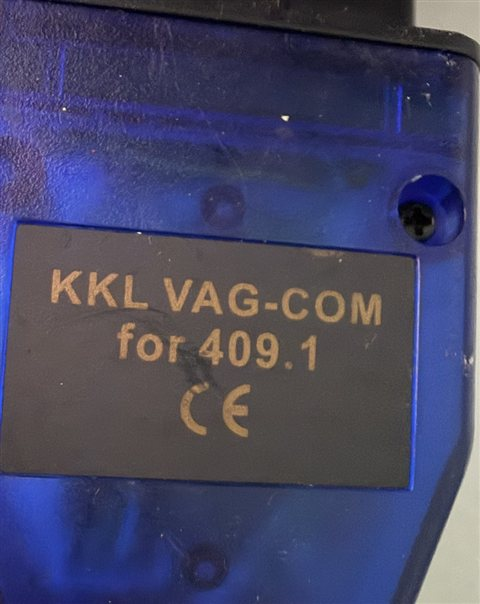
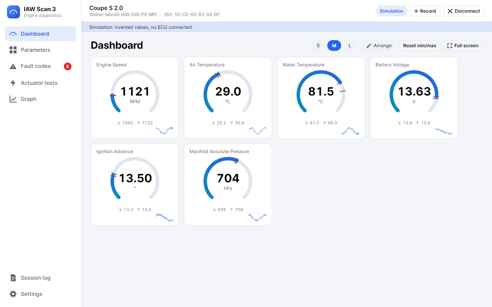

<p align="center">
  
</p>

<h1 align="center">IAW Scan 3</h1>

<p align="center">
  <strong>Diagnostics and data logging for 1990s Fiat, Lancia and Alfa Romeo engines</strong><br>
  Marelli IAW engine ECUs and the FIAT CODE immobiliser, over a K-line cable. A fork of IAW Scan 2 by Tomasz Orczyk.
</p>

<p align="center">
  <a href="https://github.com/intilinux-eng/iaw-scan-3/releases/download/v0.2.1-beta/IAWScan3-0.2.1-beta-win-x64.exe"></a>
</p>

<p align="center">
  Version 0.2.1-beta ·
  <a href="https://github.com/intilinux-eng/iaw-scan-3/releases/latest">All downloads and release notes</a> ·
  <a href="#install-on-windows-11">Install</a> ·
  <a href="docs/desktop/user-guide.md">User guide</a> ·
  <a href="#whats-different-from-the-original-iaw-scan-2">What's new</a> ·
  <a href="#on-linux-work-in-progress">On Linux: work in progress</a> ·
  <a href="README.it.md">Italiano</a>
</p>


> **Beta, provided with no warranty of any kind and at your own risk**, including no warranty that it will correctly diagnose your vehicle. See [how far it has been tested](#how-far-it-has-been-tested).

## What it does

- **Reads your engine live:** gauges, every parameter the ECU reports, a graph with a lane and a scale for each one.
- **Reads and clears fault codes,** tells you when they appeared and went away, and runs **actuator tests** and **adjustments**.
- **Keeps a log of every session,** which you can reopen, compare and export as a ZIP ready to study or hand to an AI assistant.
- **Decodes values exactly like the original program.** The formulas are unchanged, and an automated test fails if they ever differ.

**Also under way, on Linux:** a remote web interface and an LED matrix display, both on the Arduino UNO Q. [See where they stand](#on-linux-work-in-progress).

<a name="install-the-desktop-app"></a>

## Install on Windows 11

1. Download **[`IAWScan3-0.2.1-beta-win-x64.exe`](https://github.com/intilinux-eng/iaw-scan-3/releases/download/v0.2.1-beta/IAWScan3-0.2.1-beta-win-x64.exe)**.
2. Run it. There's nothing to install, and .NET is included. Windows may warn that the file comes from an unknown publisher, because it isn't signed: click **More info**, then **Run anyway**.
3. Plug in the K-line cable. **There's nothing to install:** the first time, Windows 11 downloads the driver from the internet by itself. The cable then shows up in the program's list. [How to check it](docs/desktop/user-guide.md#checking-the-cable-on-windows-11).

### Try it right away, with no car

On the **Connect** page, pick a car, turn on **Simulation** and click **Connect**. The values are invented, but every screen works.

### Connect to your car

You need:

1. **A USB K-line cable:** a standard **VAG-COM KKL 409.1** type. [All about the cable](#the-cable). ELM327 scanners will **not** work with these cars.
2. **A Fiat 3-pin to OBD-II 16-pin adapter:** these cars have a triangular 3-pin diagnostic socket, usually under the bonnet near the firewall or strut turret, or under the passenger glovebox for the FIAT CODE immobiliser. The adapter's clips go on the battery: that socket has no 12 V, and the cable needs it.

Then, with the ignition on: find your car in the list, check the cable, and click **Connect**. **Test the cable** checks it first, even with no car. The [user guide](docs/desktop/user-guide.md) explains every screen.

## The cable



This is the cable the project is tested with:

| | |
|---|---|
| **Cable** | USB to OBD-II, labelled **KKL VAG-COM for 409.1** |
| **USB chip** | **CH340** (USB ID `1A86:7523`) |
| **On Windows 11** | Nothing to install: the first time it's plugged in, Windows downloads the driver from the internet by itself. It then appears as `USB-SERIAL CH340 (COM5)` |
| **Adapter** | Fiat 3-pin to OBD-II 16-pin, with clips for the battery |

The program doesn't depend on the chip, so cables with an FTDI chip, the other common kind, should work the same way. Whatever you have, **Test the cable** tells you where you stand.

<br clear="right">

### The 12 V clips are needed

The cable has two sides. The USB side runs on the computer's power, which is why the port appears even with the clips off. The K-line side, which talks to the ECU, runs on the 12 V from the clips, and Fiat's 3-pin socket doesn't supply it.

You can check this with no car. Transmit and receive share one wire, so a K-line side that works hands back every byte it sends. Measured on this cable, 8 bytes each at 1200, 7680 and 9600 baud:

| 12 V | Bytes that came back | Round trip at 7680 baud |
|---|---|---|
| Off | 0 of 24 | - |
| On | **24 of 24**, all correct | 3.4 ms |

### How the program handles it

- **Finding it.** The list of ports updates by itself every 2 seconds and says what each one is: `COM5 · USB-SERIAL CH340`. Cables come first, and the one used last time is remembered.
- **Testing it.** **Test the cable** works with no car: it sends 3 bytes at 1200 baud and 6 at 7680, the two speeds the ECUs use, and expects each one back. It then says whether the cable works, whether the 12 V seems to be missing, or whether the line isn't clean.
- **If Windows has no driver.** A cable with a known chip that's plugged in without a working driver is reported on the Connect page, with a link to the chip maker's page. Drivers aren't bundled with the program: Windows Update already provides them, and FTDI's license warns that its driver can damage non-genuine chips, which cheap cables may use.
- **Connecting.** 8 data bits, no parity, 1 stop bit, DTR and RTS off. It listens at 1200 baud for up to 10 seconds for the ECU announcing itself, sends the wake-up bytes `0F AA CC`, and carries on at 7680 baud.
- **If nothing answers.** It checks the echo. With none, it stops and says the cable's K-line side isn't answering. With an echo, it connects as the original did and says the cable answers but the ECU didn't identify itself, so you can turn the ignition on and reconnect.
- **Reading.** One byte at a time: send the request, discard the echo, read the reply, waiting up to 300 ms, with a 4 ms pause before the next. Two requests in a row without an answer mean communication is lost.
- **Timing on Windows.** While connected, the program asks Windows for a 2 ms timer, as the original did, so those pauses really are that short.

## The app at a glance

<table>
<tr>
<td width="50%"><br><sub><b>Connect:</b> search for your car; the cable is found by itself, and can be tested with no car</sub></td>
<td width="50%"><br><sub><b>Parameters:</b> choose what to read, with live values</sub></td>
</tr>
<tr>
<td><br><sub><b>Fault codes:</b> always read, with what changed during the session</sub></td>
<td><br><sub><b>Actuator tests:</b> each one asks first</sub></td>
</tr>
<tr>
<td><br><sub><b>Graph:</b> a lane and a scale for each parameter, zoom and pointer readings</sub></td>
<td><br><sub><b>Recorded session:</b> compared with another (dashed), figures and events</sub></td>
</tr>
<tr>
<td><br><sub><b>Session log:</b> every connection, ready to reopen or export</sub></td>
<td><br><sub><b>Light theme,</b> if you prefer it to the dark one</sub></td>
</tr>
</table>

## What's different from the original IAW Scan 2

This project is a fork of [IAW Scan 2](http://iaw-scan2.sourceforge.net) v0.85 by Tomasz Orczyk ("TzOk"), itself the successor of IAW ECU Scan. **Of the original, it keeps the diagnostic engine:** how signals are read from the ECU and decoded, in `IES_3.Core`, and the same way of handling the serial port and connection. Everything around it is new.

| | **IAW Scan 2 v0.85** | **IAW Scan 3** |
|---|---|---|
| **Decoding formulas** | The reference | **Identical**, checked by an automated test |
| **Runs on** | Windows 2000 to 7, on .NET Framework 2.0. Last release: May 2015 | Windows 11, on .NET 10. Linux: [work in progress](#on-linux-work-in-progress) |
| **Installing** | Needs .NET Framework 2.0 | One 32 MB file, .NET included |
| **Interface** | Windows Forms, tabs and tables | New: sidebar, gauges, dark and light themes |
| **Interface languages** | 7 (English, German, Croatian, Italian, Polish, Portuguese, Serbian) | English and Italian for now |
| **Finding your ECU** | Choose the ECU family; automatic detection from the ISO code | Search for your car by name, or choose the family. Automatic detection was removed after proving unreliable on real hardware |
| **Finding the cable** | A list of bare port names, read once at start-up: a cable plugged in later means restarting the program. When a connection fails, nothing tells the cable from the car | The list updates by itself and says what each port is (`COM5 · USB-SERIAL CH340`), cable first. **Test the cable** works with no car and says if the 12 V is missing. A failed connection says whether it's the cable or the ECU, and a missing driver is pointed out |
| **Trying it without a car** | A hidden Ctrl+click | A switch on the Connect page |
| **Live values** | One table | Gauges with lowest and highest values, recent history, your own layout, full screen |
| **Parameters sharing a byte** | Turning one off silently froze the other | Each keeps updating |
| **Graph** | One scale for everything, so 6000 rpm flattens 14 V; only while recording | A lane and a scale for each, zoom, pan, pointer readings, always on, up to an hour |
| **Recording** | By hand, one CSV in the folder the program was started from, with the other tabs locked meanwhile. A text log if ticked | Every session logged, automatically if you want, with its events and a size limit. Every page stays usable |
| **Reviewing later** | Open the CSV elsewhere | Reopen inside the program, compare two sessions, jump to an event |
| **Exporting** | CSV | ZIP with data, events and a description of the format, ready for a script or an AI assistant |
| **Fault codes** | Read on their tab, or with the parameters if a box is ticked | Always read, with a live count and a history of what appeared and went away |
| **Clearing codes, actuator tests** | The `C` key clears codes at once, tests start at a click | Always ask first; no single-key shortcut |
| **While talking to the ECU** | The window stops responding during connection and adjustments | It keeps responding: everything on the serial line runs in the background |
| **In the car** | No | [Fiat Coupé unit on the Arduino UNO Q](#remote-web-interface-on-the-arduino-uno-q), used from your phone (work in progress) |
| **Automated tests** | No | Yes, on Windows and Linux, including an emulated ECU |

The original Windows Forms interface is no longer included. Change by change, in plain language: [CHANGELOG.md](CHANGELOG.md). The original project's own history: [readme.txt](readme.txt).

## Supported vehicles and ECUs

<details>
<summary><b>Show the complete list of cars and ECUs</b></summary>

### By vehicle

#### Fiat
| Model | Engine / Specification | Fuel System | ECU |
|---|---|---|---|
| **Cinquecento** | 899cc (0.9) SPI (ECE F2) | SPI | Magneti-Marelli IAW-6F / 16F |
| **Cinquecento Sporting** | 1108cc (1.1) FIRE SPI (ECE F2) | SPI | Magneti-Marelli IAW-6F / 16F |
| **Seicento** | 899cc (0.9) SPI (CM, F2) | SPI | Magneti-Marelli IAW-6F / 16F |
| **Panda** (141) | 899cc SPI (ECE F2) | SPI | Magneti-Marelli IAW-6F / 16F |
| **Panda** (141) | 1000cc (1.0) FIRE SPI (ECOL / ECE F2) | SPI | Magneti-Marelli IAW-6F / 16F |
| **Panda / Selecta** (141) | 1108cc (1.1) FIRE SPI CA (ECE F2) | SPI | Magneti-Marelli IAW-6F / 16F |
| **Panda 4x4** (141) | 1108cc (1.1) FIRE SPI 4x4 (ECE F2) | SPI | Magneti-Marelli IAW-6F / 16F |
| **Punto 55** (176) | 1.1 FIRE SPI (5M/6M, ECE F2 / Em.04 Est Europa) | SPI | Magneti-Marelli IAW-6F / 16F |
| **Punto 60 / Selecta** (176) | 1.2 (1242cc) FIRE SPI (CM, ECE F2 T.i.T.) | SPI | Magneti-Marelli IAW-6F / 16F |
| **Punto 75** (176) | 1.2 (1242cc) FIRE 8V MPI (ECE F2 / ECOL) | MPI | Magneti-Marelli IAW-8F / 18F |
| **Punto 85 16V** (176) | 1.2 (1242cc) FIRE 16V MPI (CEE F2) | MPI | Magneti-Marelli IAW-18FD |
| **Coupé 2.0 16V** | 2.0 16V N/A (Lampredi / Pratola Serra) | MPI | Weber-Marelli IAW-04K.P8 |
| **Coupé 2.0 16V Turbo** | 2.0 16V Turbo / Plus (T/C, ESSE) | MPI | Weber-Marelli IAW-04K.P8 |
| **Tipo** | 1.4 / 1372cc SPI (ECE 04, TOFAS) | SPI | Magneti-Marelli IAW-6F / 16F |
| **Tipo / Tempra** | 1.6 SPI (USA'83 / Em.04, TOFAS) | SPI | Magneti-Marelli IAW-6F / 16F |
| **Tipo / Tempra** | 1.8 8V MPI (Bn/Sw, ECE F2) | MPI | Magneti-Marelli IAW-8F / 18F |
| **Tipo 2000 16V** | 2.0 16V Sedicivalvole (Tipo 2.0 16V) | MPI | Weber-Marelli IAW-04K.P8 |
| **Tempra 2.0** | 2.0 8V (M/T, A/T, 4x4) | MPI | Weber-Marelli IAW-04K.P8 |
| **Palio** | 1.0 8V (IAW-1G7SD) | MPI | Magneti-Marelli IAW-18FD / 1G7 |
| **Palio** | 1.2 FIRE 8V (ECE F2) | MPI | Magneti-Marelli IAW-8F / 18F |
| **Siena** | 1.4 8V (IAW-1G7SP) | MPI | Magneti-Marelli IAW-18FD / 1G7 |
| **131** (TOFAS / Şahin / Doğan / Kartal) | 1.6 SPI USA'83 (Bn/Sw) | SPI | Magneti-Marelli IAW-6F / 16F |

#### Lancia
| Model | Engine / Specification | Fuel System | ECU |
|---|---|---|---|
| **Y / Ypsilon** (840) | 1.2 (1242cc) SPI (CM / CA, ECE F2) | SPI | Magneti-Marelli IAW-6F / 16F |
| **Delta II (Nuova Delta 836)** | 1.8 8V MPI (90 CV / Bn / Sw, ECE F2) | MPI | Magneti-Marelli IAW-8F / 18F |
| **Delta II (Nuova Delta 836)** | 2.0 16V N/A | MPI | Weber-Marelli IAW-04K.P8 |
| **Delta II HF Turbo (Nuova Delta 836)** | 2.0 16V Turbo / T/C (4x2) | MPI | Weber-Marelli IAW-04K.P8 |
| **Delta II (Nuova Delta 836)** | 2.0 8V T/C | MPI | Weber-Marelli IAW-04K.P8 |
| **Delta HF Integrale** | Evoluzione 2.0 16V 4x4 (Evo 1 / Evo 2 Kat ECO) | MPI | Weber-Marelli IAW-04K.P8 |
| **Dedra** (835) | 1.8 8V MPI (Bn / Sw, ECE F2) | MPI | Magneti-Marelli IAW-8F / 18F |
| **Dedra** (835) | 2.0 8V (A/T) | MPI | Weber-Marelli IAW-04K.P8 |
| **Dedra** (835) | 2.0 16V FWD & Integrale 4x4 | MPI | Weber-Marelli IAW-04K.P8 |

#### Alfa Romeo
| Model | Engine / Specification | Fuel System | ECU |
|---|---|---|---|
| **145** (930) | 1.3 / 1351cc Boxer MPI (ECE F2) | MPI | Magneti-Marelli IAW-8F / 18F |
| **146** (930) | 1.3 / 1351cc Boxer MPI (ECE F2) | MPI | Magneti-Marelli IAW-8F / 18F |
| **155** (167) | 2.0 16V Q4 / 4x4 Turbo | MPI | Weber-Marelli IAW-04K.P8 |
| **33** (907) | 1.3 / 1360cc Boxer MPI CM (Late Boxer) | MPI | Magneti-Marelli IAW-8F.68 |

### Supported ECU systems

| ECU Identifier | Fuel Injection | Diagnostic Protocol | Typical Applications |
|---|---|---|---|
| **Magneti-Marelli IAW-6F / IAW-16F** | Single-Point (SPI) | ISO 9141 (K-Line), 7680 baud | Fiat Cinquecento, Seicento, Panda, Punto 55/60, Tipo/Tempra 1.4/1.6, Lancia Y 1.2 |
| **Magneti-Marelli IAW-8F / IAW-18F** | Multi-Point (MPI) | ISO 9141 (K-Line), 7680 baud | Fiat Punto 75, Palio 1.2, Tipo/Tempra 1.8, Lancia Delta/Dedra 1.8, Alfa Romeo 145/146 1.3 Boxer |
| **Magneti-Marelli IAW-18FD / IAW-1G7** | Multi-Point (MPI) | ISO 9141 (K-Line), 7680 baud | Fiat Punto 85 16V (1.2 FIRE 16V), Palio 1.0, Siena 1.4 |
| **Magneti-Marelli IAW-8F.68** | Multi-Point (MPI) | ISO 9141 (K-Line), 7680 baud | Alfa Romeo 33 1.3 Boxer |
| **Weber-Marelli IAW-04K.P8** | Multi-Point (MPI) | ISO 9141 (K-Line), 7680 baud | Fiat Coupé 2.0 16V & Turbo, Tipo 2.0 16V, Lancia Delta HF Integrale Evo, Nuova Delta 2.0 16V/Turbo, Dedra 2.0 16V/Integrale, Alfa Romeo 155 Q4 |
| **FIAT CODE** | Factory Immobiliser | ISO 9141 (K-Line), 7680 baud | First-generation immobiliser diagnostic readouts and error status across all equipped vehicles |

</details>

## On Linux: work in progress

The main project is the Windows 11 app above. On Linux, work is under way on an in-car unit built around the **Arduino UNO Q**, a board that runs Linux, and on the desktop app itself. **None of this has been run on a car yet.**

| | What it is | Where it stands |
|---|---|---|
| [Remote web interface](#remote-web-interface-on-the-arduino-uno-q) | On the UNO Q, used from your phone over its Wi-Fi, with an always-on logger | Built, tested in simulation only |
| [LED matrix](#led-matrix-on-the-arduino-uno-q) | Active faults on the UNO Q's own LEDs, with no phone needed | Design only, nothing built yet |
| [Desktop app on a Linux PC](#the-desktop-app-on-a-linux-pc) | The same app as on Windows | Package available, tested against an emulated ECU but not with a real cable |

### Remote web interface on the Arduino UNO Q


For the **Fiat Coupé**: an Arduino UNO Q stays in the car, plugged into the diagnostic socket and powered from the ignition. Your phone joins its Wi-Fi and opens `http://192.168.4.1`, with no app and no internet.

- At every ignition-on it connects to the ECU by itself and logs every parameter, fault code and event, with or without a phone around.
- It's built to have its power simply cut at key-off.
- It takes the date and time from your phone, and works out the times of whatever it recorded before you connected.
- Each drive downloads as a ZIP for analysis.

**What it takes, besides the K-line cable:** the UNO Q has a single USB-C port, so it needs a USB-C hub with Power Delivery, which powers the board and gives the cable a USB port, and a 12 V to USB-C PD supply of at least 15 W, switched by the ignition.

**It has only been tested in simulation: it has never run on a real UNO Q or been connected to a car.** Installing it means flashing and wiring a board, so it's for people comfortable with that.

Packages: [experimental pre-release](https://github.com/intilinux-eng/iaw-scan-3/releases/tag/coupe-experimental). Documentation, in Italian: [overview](docs/coupe/README.md) · [installing on the UNO Q](docs/coupe/installazione-uno-q.md) · [user guide](docs/coupe/guida-uso.md) · [logbook format](docs/coupe/registro-dati.md).

<br clear="right">

### LED matrix on the Arduino UNO Q

The UNO Q has a built-in LED matrix, so the unit could show active faults with no phone around: three letters for each fault, and a dot per fault along the bottom. **It isn't built yet, and these are simulations, not photos.** [The design](docs/coupe/matrice-led.md) (in Italian) has every screen and every code.

<table>
<tr><td width="25%"><br><sub>No active faults</sub></td><td width="25%"><br><sub>One active fault</sub></td><td width="25%"><br><sub>It turns on the engine warning light</sub></td><td width="25%"><br><sub>Several, 2 seconds each</sub></td></tr>
</table>

### The desktop app on a Linux PC

For Debian, Ubuntu and derivatives, 64-bit. A real cable hasn't been tried on Linux yet.

1. Download **[`iaw-scan3_0.2.1-beta_amd64.deb`](https://github.com/intilinux-eng/iaw-scan-3/releases/download/v0.2.1-beta/iaw-scan3_0.2.1-beta_amd64.deb)**.
2. From the folder you downloaded it to, install it with `apt`, which also fetches the libraries it needs:
   ```
   sudo apt install ./iaw-scan3_0.2.1-beta_amd64.deb
   ```
3. Allow your user to use the cable, then **log out and back in**:
   ```
   sudo usermod -aG dialout $USER
   ```
4. Start **IAW Scan 3** from the applications menu, or with `iaw-scan3`.

To remove it: `sudo apt remove iaw-scan3`. Your sessions stay in `~/.local/share/IAWScan3` until you delete them.

The cable's driver is part of the kernel. On Ubuntu, the `brltty` package can grab CH340 cables and make the port disappear: if so, `sudo apt remove brltty`, unless you use a braille display.

## How far it has been tested

| | How it was verified |
|---|---|
| **Decoding formulas** | Every parameter and fault of every ECU, over a set of raw values: 2745 results recorded from the untouched original code, and compared on every build |
| **The whole application** | Automated tests in simulation, on Windows and Linux. The final Windows `.exe` driven through its real controls. The Linux package checked with a trial `apt` install (nothing changed on the system), unpacked and started, under WSL |
| **Serial port on Linux** | The full connect, polling, fault codes, tests, clearing and lost-communication flow, automated, against an emulated ECU on a Linux pseudo-terminal, including the unusual 7680 baud |
| **A real USB cable on Windows** | A CH340 cable on Windows 11, with no car: found by itself, cable test and connection flow run for real, echo measured with and without its 12 V |
| **A real ECU on Windows** | The engine and the connection logic are those the earlier betas of this fork ran with on a Fiat Coupé 2.0 16V. **This new interface hasn't been run on a real car yet** |
| **A real USB cable on Linux** | **Not yet** |
| **The UNO Q in-car unit** | **Only in simulation.** Never run on a real board or in a car |
| **Other cars** | The vehicle tables come from the original project. They haven't all been checked again in this fork |

A report from a real car is the most useful thing you can send, whether it works or not: [open an issue](https://github.com/intilinux-eng/iaw-scan-3/issues).

## For developers

```
IES_3.Core/      Diagnostic engine from IAW Scan 2: reading and decoding ECUs. Unchanged.
IES_3.Session/   Connection, polling, active diagnostics, recording and reading back sessions.
IES_3.Avalonia/  The desktop app (Avalonia, MVVM). Packaging in packaging/.
IES_3.Coupe/     The Fiat Coupé edition: web server and interface. Packaging in packaging/.
IES_3.Tests/     Reference values for the formulas, the app driven in simulation, the emulated ECU.
```

With the [.NET 10 SDK](https://dotnet.microsoft.com/download):

```
dotnet run --project IES_3.Avalonia        # run the desktop app
dotnet test IES_3.Tests                    # run the tests (the emulated ECU needs Linux)

dotnet publish IES_3.Avalonia -c Release -r win-x64 -o publish/win-x64           # the .exe
bash IES_3.Avalonia/packaging/build-deb.sh 0.2.0-beta                            # the .deb, on Linux or WSL
bash IES_3.Coupe/packaging/build-deb.sh 0.1.0-experimental                       # the Coupé .deb
IAW_SCREENSHOTS="$PWD/docs/screenshots" dotnet test IES_3.Tests --filter ScreenshotTests  # these screenshots
```

macOS isn't packaged: nothing in the code rules it out, but it hasn't been tried.

## License

Modified BSD license, see [license.txt](license.txt). Copyright (c) 2011, Tomasz Orczyk. This fork builds on [IAW Scan 2](http://iaw-scan2.sourceforge.net): the credits are also in the program, under Settings.

Open source components: .NET, Avalonia, CommunityToolkit.Mvvm, SkiaSharp and HarfBuzzSharp (MIT), and the Inter font (SIL Open Font License 1.1).

**In plain words: no warranty.** This software is provided "as is", with no warranty of any kind, express or implied, including no warranty that it will correctly diagnose your vehicle. The author(s) and contributors are not liable for any damage, to your car or otherwise, arising from its use.
