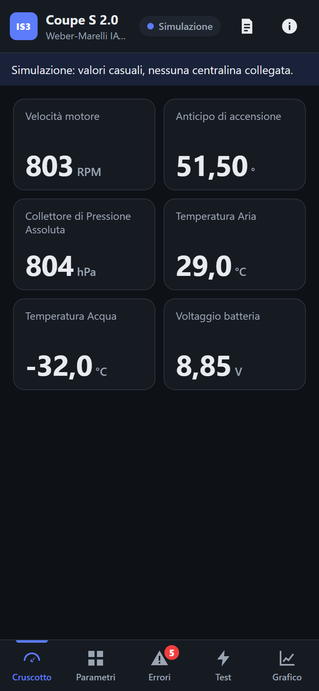
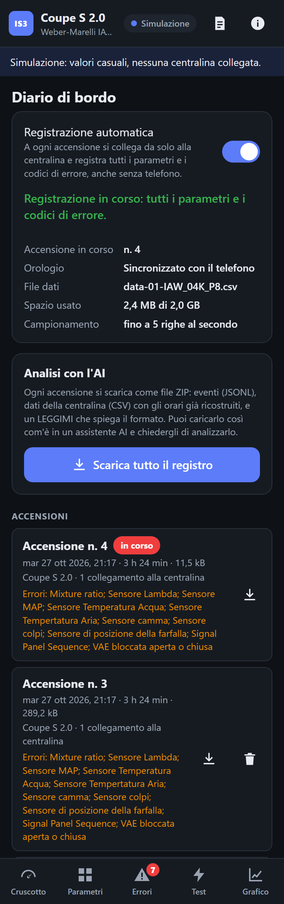

# IAW Scan 3 Coupé (progetto sperimentale)

**Diagnosi e registro dati per Fiat Coupé, dal telefono.** È un'estensione di IAW Scan 3, un fork di IAW Scan 2 di Tomasz Orczyk. Gira su una scheda **Arduino UNO Q** che resta montata in auto, collegata alla presa diagnostica e alimentata dal quadro. Il telefono si collega alla rete Wi-Fi della scheda e l'interfaccia si apre nel browser: non c'è nessuna app da installare e non serve internet.

| | |
|---|---|
|  |  |
| Cruscotto con i parametri scelti | Diario di bordo: ogni accensione, scaricabile per l'analisi |

> **Progetto sperimentale, mai provato su hardware reale.** Il motore diagnostico è quello di IAW Scan 2, collaudato da anni. Questa edizione però (server web, registratore dati, pacchetto per la UNO Q) è stata provata solo in simulazione, su Windows e su Linux (WSL). Non è mai stata eseguita su una UNO Q né collegata a una Coupé. In particolare non sono verificati la modalità Access Point della UNO Q e il cavo K-line collegato tramite hub USB-C. Fornita **senza alcuna garanzia**: vedi [License](../../README.md#license).

## Cosa fa

- **Solo Fiat Coupé.** Due centraline:
  - **Centralina motore Weber-Marelli IAW-04K.P8**: Coupé 2.0 16V aspirato, 2.0 16V Turbo e Turbo "ESSE".
  - **Immobilizer FIAT CODE.**

  Le altre auto e centraline di IAW Scan 3 non sono offerte. Se il codice ISO letto non corrisponde a una Coupé nota, viene mostrato un avviso.
- **Cruscotto** con i parametri che scegli, a caratteri grandi. Funziona anche con il telefono in orizzontale sul supporto in auto.
- **Parametri, errori, test attuatori, grafico** in tempo reale, come nella versione per PC. Le regolazioni non ci sono perché queste due centraline non ne prevedono.
- **Registratore dati sempre attivo.** A ogni giro di chiave la scheda si accende, si collega da sola alla centralina e registra tutti i parametri e i codici di errore, anche se nessun telefono è collegato. Il registro annota anche quando il dispositivo si è acceso e spento, quando gli errori compaiono e scompaiono, i test eseguiti e così via.
- **Esportazione per l'analisi con l'AI.** Ogni accensione si scarica come file ZIP con gli eventi (JSONL), i dati (CSV) e un `LEGGIMI.md` che ne descrive il formato. Si può caricare così com'è in un assistente AI.
- **Data e ora dal telefono.** La UNO Q non ha un orologio a batteria: prende l'ora dal primo telefono che apre l'interfaccia e ricostruisce gli orari degli eventi precedenti.

## Come è fatto

```
 Quadro (12 V) ──► alimentatore USB-C PD ──► hub USB-C ──► Arduino UNO Q (Debian)
                                                 │            │
                                                 │            ├─ servizio iaw-scan3-coupe (.NET)
                                                 │            │    · motore diagnostico IAW Scan 2 (invariato)
                                                 │            │    · registratore dati → /var/lib/iaw-scan3-coupe
                                                 │            │    · interfaccia web  → http://192.168.4.1
                                                 │            └─ rete Wi-Fi "IAW-Coupe-xxxx" (Access Point)
                                                 │                       ▲
                                                 └─ cavo K-line USB      │ Wi-Fi
                                                     │                   │
                                         presa diagnostica 3 poli     telefono (browser)
```

Nel repository:

- `IES_3.Coupe/` è il server: ASP.NET Core più l'interfaccia web in `wwwroot/`, senza dipendenze esterne. Usa la stessa libreria di connessione e lettura della centralina della versione desktop (`IES_3.Session`) e il motore `IES_3.Core`, invariato.
- `IES_3.Coupe/packaging/` contiene il pacchetto Debian arm64: servizio systemd, regola udev per i cavi FTDI e lo script `iaw-coupe-setup` (Access Point e ottimizzazioni).

## Documentazione

- [Installazione su Arduino UNO Q](installazione-uno-q.md): preparare il Debian della scheda, installare il pacchetto, configurare la rete Wi-Fi e ottimizzare per l'uso in auto, poi il collegamento elettrico.
- [Guida all'uso](guida-uso.md): dal primo collegamento del telefono a ogni schermata, diario e analisi con l'AI compresi.
- [Formato del registro dati](registro-dati.md): cartelle, eventi, CSV, orari ed esportazione, per chi vuole analizzare i dati con i propri strumenti.

## Provarla senza scheda e senza auto

Su un PC con il [.NET 10 SDK](https://dotnet.microsoft.com/download):

```
dotnet run --project IES_3.Coupe/IES_3.Coupe.csproj -- --urls http://0.0.0.0:5000
```

Apri `http://localhost:5000` (o `http://<indirizzo-del-PC>:5000` dal telefono sulla stessa rete), attiva **Modalità simulazione** e tocca **Connetti**. Impostazioni e registro (`settings.json`, `datalog/`, `Log/`) vengono creati nella cartella da cui lanci il comando. I valori simulati sono casuali. Di norma le sessioni simulate non finiscono nel registro dati. Per provare anche il registratore, imposta la variabile d'ambiente `IAW_LOG_SIMULATION=1` prima di avviare.
