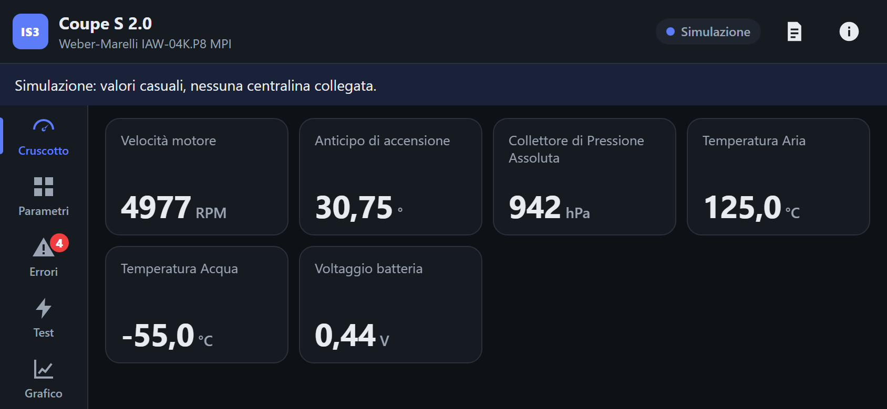
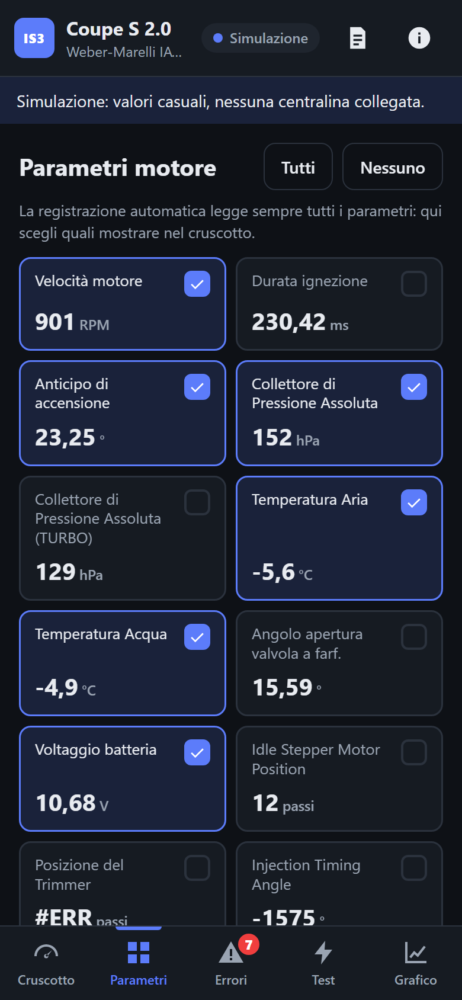
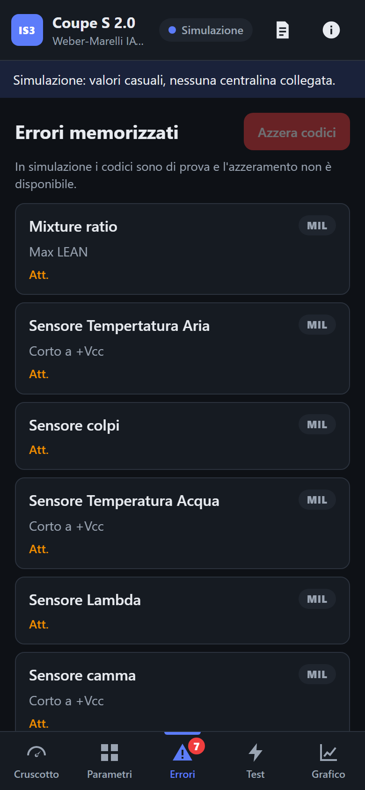

# Guida all'uso di IAW Scan 3 Coupé

Come usare il dispositivo dal telefono, una volta installato in auto come descritto nella [guida di installazione](installazione-uno-q.md).

> **Progetto sperimentale:** non ancora provato su un'auto vera. Verifica ciò che legge prima di fidarti, e tieni presente che i test attuatori comandano componenti reali.

> **Non usare il telefono mentre guidi.** Il cruscotto è pensato per un telefono fissato su un supporto, da guardare come uno strumento, ma ogni operazione (scegliere parametri, avviare test, scaricare il registro) va fatta **ad auto ferma**.

## Primo collegamento del telefono

1. **Gira la chiave su MAR.** La scheda si accende con il quadro e impiega qualche decina di secondi ad avviarsi.
2. **Collega il telefono alla rete `IAW-Coupe-XXXX`.** Il modo più comodo è inquadrare il codice QR mostrato durante l'installazione, altrimenti inserisci la password a mano. Se il telefono avvisa che la rete non ha accesso a internet, scegli **Resta connesso**.
3. **Apri `http://192.168.4.1`** nel browser (Chrome, Safari...).
4. **Consigliato:** dal menu del browser scegli **Aggiungi a schermata Home**, così la ritrovi come un'app. Per il cruscotto sul supporto, allunga il tempo di spegnimento dello schermo del telefono. Su Android puoi usare il pulsante **Schermo intero** in alto.

Ogni volta che un telefono apre la pagina, il dispositivo ne prende **data e ora**: la scheda non ha un orologio a batteria. Basta aprirla una volta per viaggio perché tutto il registro di quel viaggio abbia gli orari giusti, anche la parte registrata prima.

## La barra in alto

- **Titolo:** il modello riconosciuto (per esempio "Coupe S 2.0") e la centralina collegata.
- **Stato:**

  | Stato | Significato |
  |---|---|
  | **Registra** (punto rosso) | Collegato alla centralina, registrazione dati in corso. |
  | **Connesso** | Collegato alla centralina, senza registrazione. |
  | **Cerca ECU** | Il registratore automatico sta cercando la centralina. |
  | **Simulazione** | Valori di prova, nessuna centralina. |
  | **Persa** | La centralina ha smesso di rispondere. |
  | **Offline** | Il telefono non raggiunge il dispositivo (fuori portata, scheda spenta). |
- **Icone:** schermo intero (Android), **Diario di bordo** e **Informazioni**.

## Schermata iniziale

Con la registrazione automatica attiva, che è l'impostazione predefinita, di solito non serve fare nulla: a ogni accensione il dispositivo si collega da solo alla centralina. Il riquadro **Registrazione automatica** dice cosa sta facendo: in ricerca, in registrazione, in pausa, cavo non collegato.

Per collegarti a mano, per esempio all'immobilizer:

1. Se il registratore sta cercando la centralina, tocca **Metti in pausa**.
2. Scegli **Centralina motore** (IAW-04K.P8) o **Immobilizer** (FIAT CODE). Sotto ciascuna sono elencate le versioni di Coupé riconosciute.
3. Controlla il **cavo K-line**: di solito `/dev/ttyUSB0`. Il pulsante ↻ aggiorna l'elenco.
4. Tocca **Connetti**. L'attesa della centralina può durare fino a 10 secondi.

La centralina scelta a mano diventa quella usata dal registratore alle accensioni successive. **Modalità simulazione** serve a provare l'interfaccia senza auto: i valori sono casuali e non finiscono nel registro. Mentre la simulazione è aperta la centralina vera non viene registrata; quando la chiudi, il registratore torna a cercarla da solo.

## Cruscotto

 

I parametri scelti, a caratteri grandi. Con il telefono in orizzontale sul supporto, le schede di navigazione si spostano a sinistra per lasciare tutta l'altezza ai valori. `#ERR` significa che la centralina non ha risposto validamente per quel valore.

## Parametri

Tutti i parametri della centralina. Tocca un riquadro per aggiungerlo al cruscotto o toglierlo. **Tutti** e **Nessuno** agiscono su tutti i riquadri insieme. La scelta viene ricordata, per ciascuna centralina, anche dopo lo spegnimento.

Con la registrazione automatica attiva il dispositivo legge comunque **tutti** i parametri, che vengono registrati: la scelta riguarda solo cosa vedi. Senza registrazione vengono letti solo quelli scelti, e meno ne scegli più spesso si aggiornano.

Le due "Pressione assoluta" sono due conversioni dello stesso sensore: una per il motore aspirato, l'altra per il Turbo. Guarda quella del tuo motore.

## Errori

I codici di errore presenti in centralina, con la causa quando la centralina la indica:

- **Att.** = attivo ora, **Ver.** = verificato, **Mem.** = memorizzato.
- **MIL** rossa = l'errore accende la spia avaria motore.

Il numero sull'icona **Errori** in basso indica quanti codici sono presenti.

**Azzera codici** cancella i codici memorizzati nella centralina, dopo una conferma. Annotali prima, se ti servono: il registro dati li conserva comunque (vedi Diario). L'azzeramento non è disponibile in simulazione.

## Test attuatori

Aziona davvero un componente per verificarne il funzionamento: pompa carburante, iniettori, bobine, contagiri e altri. Ogni test chiede conferma e ha una durata massima. Si esegue con **quadro acceso e motore spento**. **Annulla** interrompe il test in corso. L'esito (Superato, Fallito, Scaduto...) compare sotto il nome.

## Grafico

L'andamento in tempo reale dei parametri scelti, sugli ultimi 15 secondi. Tocca un tracciato per escluderlo, poi **Registra**: la registrazione viene salvata anche come file CSV nello stesso formato della versione per PC, scaricabile dall'elenco **Registrazioni salvate**.

Questa è una registrazione *manuale* e mirata. Il registro dati automatico (Diario) funziona a parte e sempre.

## Diario di bordo

Il registratore dati. Con **Registrazione automatica** attiva, a ogni accensione il dispositivo:

- si collega da solo alla centralina e riprova finché non risponde;
- registra **tutti i parametri** fino a 5 volte al secondo e **i codici di errore** a ogni loro cambiamento;
- annota gli **eventi**: accensione e spegnimento del dispositivo (cioè del quadro), centralina trovata e persa, errori comparsi e scomparsi, test, azzeramenti, collegamenti del telefono, sincronizzazioni dell'orologio.

Se tocchi **Disconnetti** (in Informazioni), la registrazione automatica va **in pausa** fino all'accensione successiva o finché non tocchi **Riprendi**.

Sotto lo stato, l'elenco delle **accensioni**: data e ora (se nota), durata, veicolo, numero di collegamenti alla centralina ed errori visti. Per ciascuna:

- l'icona di **download** scarica un file ZIP;
- il **cestino** la elimina. Non si può eliminare l'accensione in corso.

**Scarica tutto il registro** scarica tutte le accensioni in un unico ZIP. Quando lo spazio (2 GB di default) si esaurisce, le accensioni più vecchie vengono eliminate automaticamente.

### Analizzare il registro con l'AI

Lo ZIP contiene, per ogni accensione:

- `events.jsonl`: gli eventi, uno per riga;
- `data-*.csv`: i valori della centralina, con gli orari già ricostruiti;
- `LEGGIMI.md`: spiega il formato, il significato di ogni evento e colonna e i limiti dei dati.

Caricalo così com'è in un assistente AI e chiedi, per esempio:

> Ti allego il registro della centralina della mia Fiat Coupé (formato descritto in LEGGIMI.md). Riassumi ogni accensione: durata, temperature dell'acqua e dell'aria raggiunte, tensione di batteria, giri motore, eventuali codici di errore e quando sono comparsi. Segnala valori fuori dal normale o andamenti sospetti e dimmi quali controlli faresti.

L'AI può sbagliare: usa le sue risposte come spunto per i controlli, non come diagnosi. Il formato è descritto in dettaglio in [registro-dati.md](registro-dati.md).

## Informazioni

Dati della centralina collegata (tipo, veicolo, codice ISO, codice ricambio) e **Disconnetti**. Contiene anche i crediti e la licenza: IAW Scan 3 Coupé si basa su IAW Scan 2 v0.85 di Tomasz Orczyk.

## Più telefoni insieme

Si possono collegare più telefoni contemporaneamente: vedono tutti la stessa sessione. Senza registrazione automatica, la schermata aperta per ultima su uno qualsiasi dei telefoni decide cosa leggere dalla centralina (parametri o errori). Con la registrazione attiva si legge sempre tutto.

## Uso portatile

Il dispositivo funziona anche fuori dall'auto in cui è installato: alimentalo da un power bank USB-C PD, collega il cavo K-line alla presa di un'altra Coupé e connettiti dal telefono. Ogni accensione finisce comunque nel Diario.
