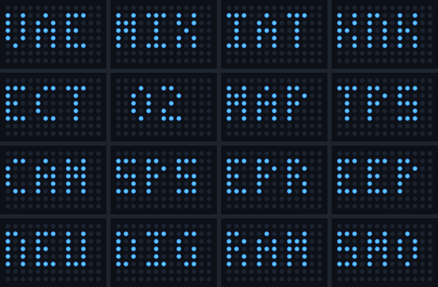
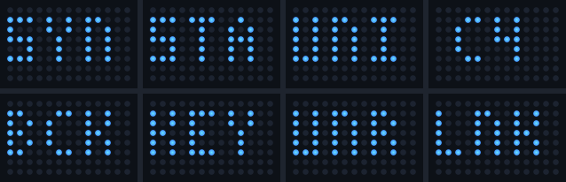

# Matrice LED: gli errori attivi a colpo d'occhio

> **Lavoro in corso, non ancora implementato.** Le immagini sono simulazioni, non foto della scheda: le disegna [`genera-anteprime.py`](matrice-led/genera-anteprime.py). Questa pagina serve a decidere cosa mostrare prima di scrivere il codice.

La Arduino UNO Q ha già una matrice di 104 LED blu, 8 righe per 13 colonne, con 8 livelli di luminosità. L'idea è usarla per sapere se la centralina segnala un guasto **senza aprire il telefono**: l'unità resta in auto a registrare, e la matrice dice come sta andando.

## Cosa mostra

### Tutto normale

| | |
|---|---|
|  | **Avvio.** La scheda si è accesa e Linux sta ancora partendo. |
|  | **Cerca la centralina.** Il programma è pronto, la centralina non ha ancora risposto. |
|  | **Nessun errore attivo.** Luce bassa, per non disturbare di notte. |
|  | **Nessun errore attivo, ma ce ne sono di memorizzati.** Un puntino debole per ciascuno, qui tre: i dettagli sono sul telefono. |

### Errori attivi

| | |
|---|---|
|  | **Un errore attivo.** La sigla resta fissa. |
|  | **Più errori attivi.** Una sigla ogni 2 secondi. In basso c'è un punto per errore, più luminoso quello mostrato. |
|  | **Errore che accende la spia motore.** Si aggiunge un `!` a destra, che lampeggia una volta al secondo. |

### Problemi di collegamento

| | |
|---|---|
|  | **Il lato K-line del cavo non risponde.** Di solito mancano i suoi 12 V. |
|  | **Comunicazione persa** con la centralina. |
|  | **Dati fermi.** La matrice non riceve aggiornamenti da qualche secondo: meglio un `?` che un errore vecchio mostrato come attuale. |
|  | **Simulazione.** I valori sono inventati. |

Il puntino debole in basso a destra, visibile in alcune immagini, indica che la registrazione è attiva.

## Le regole

- **Solo gli errori attivi hanno la sigla.** Quelli memorizzati sono solo puntini deboli.
- **Nessun lampeggio veloce.** Al massimo una volta al secondo, e niente da leggere mentre guidi: è un'occhiata da auto ferma, non un sostituto della spia sul cruscotto.
- **Non deve mai disturbare il registratore.** Se la matrice si guasta o non risponde, la diagnosi e la registrazione continuano.
- **La spia:** il `!` segue la stessa regola dell'indicazione MIL del telefono, cioè errore attivo e anche verificato o memorizzato.

## Le sigle

Queste centraline non hanno codici numerici come P0123: danno un elenco di errori con una descrizione. In 13 colonne stanno 3 lettere senza farle scorrere, quindi ogni errore ha una sigla fissa.

**Centralina motore IAW-04K.P8**



| Sigla | Errore | Sigla | Errore |
|---|---|---|---|
| `VAE` | VAE bloccata aperta o chiusa | `CAM` | Sensore camma |
| `MIX` | Rapporto della miscela | `SPS` | Signal Panel Sequence |
| `IAT` | Sensore temperatura aria | `EPR` | EPROM |
| `KNK` | Sensore colpi (battito) | `EEP` | EEPROM |
| `ECT` | Sensore temperatura acqua | `NEU` | Segnale Neutral/drive |
| `O2` | Sensore lambda | `DIG` | Segnale Digimatic |
| `MAP` | Sensore MAP | `RAM` | RAM |
| `TPS` | Sensore posizione farfalla | `SMO` | Sensore SMOT |

**Immobilizer FIAT CODE** (si vede quando l'unità è collegata alla sua presa)



| Sigla | Errore | Sigla | Errore |
|---|---|---|---|
| `SYN` | Centralina non sincronizzata con il CODE | `BCK` | Backdoor attivata |
| `STA` | La centralina non consente l'avviamento | `KEY` | Errore del codice chiave |
| `UNI` | Ricevuto il codice universale | `UNR` | Codice non corretto o sconosciuto |
| `C4` | Codice di errore sconosciuto (4) | `LNK` | Nessun codice ricevuto o collegamento assente |

## Come dovrebbe funzionare

La matrice è comandata dal microcontrollore della scheda, non da Linux, dove gira il nostro programma:

```
 servizio iaw-scan3-coupe (.NET, su Linux)
   · stessi dati che vede il telefono: errori attivi, spia, stato del collegamento
   · ne ricava cosa mostrare e lo invia ogni secondo circa
        │  Bridge della UNO Q
        ▼
 piccolo sketch sul microcontrollore
   · disegna con Arduino_LED_Matrix, a 8 livelli di luminosità
   · da solo mostra l'avvio, prima che Linux sia pronto
   · da solo passa al "?" se gli aggiornamenti si fermano
```

## Cosa resta da verificare

Nulla di questo è stato provato sulla scheda, e la UNO Q stessa non è ancora stata provata con il resto dell'unità.

- **Dal programma allo sketch:** gli esempi che usano il Bridge sono in Python e C++, va capito come parlargli da .NET.
- **Installazione:** il pacchetto Debian dovrà installare anche lo sketch sul microcontrollore.
- **Visibilità in auto:** la scheda deve stare dove la matrice si vede, e non abbiamo ancora provato di giorno al sole né di notte.
- **Leggibilità vera:** lettere come `M`, `N` e `K` in 3×5 punti vanno giudicate sui LED reali.
- **Orientamento:** va deciso come montare la scheda perché la scritta non risulti girata.
