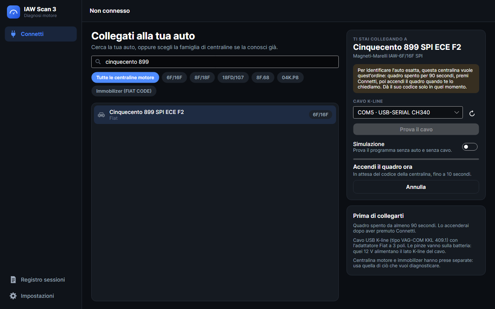
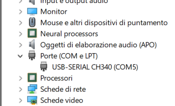

# App desktop IAW Scan 3: guida utente

Come usare l'app desktop una volta installata ([istruzioni per Windows 11](../../README.it.md#installare-su-windows-11), [PC Linux](../../README.it.md#lapp-desktop-su-un-pc-linux)). Tutto si può provare senza auto e senza cavo: attiva **Simulazione** nella pagina Connetti.

> English: [user guide](user-guide.md).

I tasti funzione valgono ovunque: **F2** Cruscotto, **F3** Parametri, **F4** Codici di errore, **F5** Test attuatori, **F6** Grafico, **F7** Regolazioni, **F8** Registro sessioni, **F9** Impostazioni, **F10** connetti o disconnetti, **F11** cruscotto a schermo intero, **Esc** annulla una domanda o esce dallo schermo intero.

## Connetti

1. **Accendi il quadro.** Il motore può essere spento o al minimo. Con una IAW-6F/16F, [per ora lascialo spento](#iaw-6f16f-identificare-lauto).
2. **Collega il cavo:** cavo USB K-line, adattatore Fiat a 3 poli sulla presa diagnostica, pinze sulla batteria. Le pinze servono: alimentano il lato K-line del cavo. Centralina motore e immobilizer FIAT CODE hanno prese separate.
3. **Cerca la tua auto** scrivendo parte del nome. Le parole possono essere in qualsiasi ordine (`coupe turbo`). Se conosci già la famiglia di centraline, clicca il suo pulsante. **Immobilizer (FIAT CODE)** elenca le auto per l'immobilizer.
4. **Controlla il cavo** sotto *Cavo K-line*. L'elenco si aggiorna da solo quando colleghi il cavo, e dice cos'è ciascuna porta: su Windows `COM5 · USB-SERIAL CH340` o simile, su Linux `/dev/ttyUSB0 · CH340`. **Prova il cavo** lo controlla, anche senza auto.
5. Clicca **Connetti** (o premi F10).

Il programma aspetta la centralina fino a 10 secondi: si annuncia da sola quando il quadro si accende. Se il quadro era spento, accendilo durante quell'attesa. A quadro già acceso, finita l'attesa il programma chiede i dati alla centralina. Le tue scelte vengono ricordate per la volta dopo.

**Se non risponde nessuno,** il programma controlla il cavo. Se il lato K-line del cavo è muto, si ferma e lo dice: controlla le pinze dell'adattatore sulla batteria e la spina. Se il cavo risponde ma la centralina non si identifica, si collega comunque, come faceva l'originale, e mostra un avviso sotto la barra di stato: controlla il quadro e che il cavo sia sulla presa giusta.

### IAW-6F/16F: identificare l'auto

Queste centraline danno il codice ISO, che indica l'auto esatta, solo da sole quando il quadro si accende, e solo se erano del tutto spente. Non c'è modo di chiederlo dopo. Spento il quadro restano in dormiveglia per circa 90 secondi, oppure si spengono del tutto quasi subito se c'è stata una sessione di diagnosi attiva, come un test attuatori.

Quindi per identificare l'auto: **quadro spento per 90 secondi, Connetti, poi quadro acceso.** Quando scegli una di queste centraline, la pagina Connetti ti guida e ti dice quando accendere il quadro:

Se il momento va perso, l'auto compare come sconosciuta e un messaggio spiega perché. La diagnosi funziona lo stesso. L'informazione viene dall'autore originale del programma ([issue #8](https://github.com/intilinux-eng/iaw-scan-3/issues/8)).

### Controllare il cavo su Windows 11

Di solito non c'è niente da fare: la prima volta che colleghi il cavo, Windows 11 scarica da solo il driver da internet, senza chiedere nulla. Pochi secondi dopo il cavo è nell'elenco del programma.

Per vederlo con i tuoi occhi:

1. Fai clic destro su **Start** e scegli **Gestione dispositivi**.
2. Apri **Porte (COM e LPT)**. Il cavo è lì, con il numero della sua porta:

Un cavo CH340 compare come `USB-SERIAL CH340`, uno FTDI come `USB Serial Port`. Il numero può essere diverso, e può cambiare se usi un'altra presa USB: il programma lo trova comunque.

Se non c'è:

- **È sotto Altri dispositivi, con un triangolo di avviso:** manca il driver, per esempio perché la prima volta il computer era senza internet. Collegati a internet e ricollega il cavo, oppure guarda in Impostazioni, Windows Update, Opzioni avanzate, Aggiornamenti facoltativi. Lo segnala anche la pagina Connetti, con un link alla pagina dei driver del produttore del chip.
- **Collegandolo non cambia nulla:** prova un'altra presa USB. Se non compare mai niente, il cavo può essere guasto.

### La prova del cavo

**Prova il cavo** non ha bisogno dell'auto. Funziona perché trasmissione e ricezione condividono un solo filo: un lato K-line che funziona rimanda indietro ogni byte che invia. Meglio farla a quadro spento, perché una centralina accesa può parlare sulla linea nello stesso momento.

| Cosa dice | Cosa significa |
|---|---|
| Il cavo funziona | Rispondono sia il lato USB sia il lato K-line. Se poi la connessione fallisce, guarda l'auto: quadro, presa |
| Il lato USB funziona, ma il lato K-line non risponde | Di solito mancano i 12 V: le pinze dell'adattatore non sono sulla batteria, o la spina non è inserita fino in fondo |
| Il cavo risponde, ma non in modo pulito | C'è altro sulla linea, o il cavo è guasto. Riprova a quadro spento |
| Impossibile aprire la porta | La sta usando un altro programma. Su Linux, controlla anche il gruppo `dialout` |

## Cruscotto

I parametri che hai scelto, a lancette. Su ciascuno:

- l'**arco** mostra il valore su una scala che si allarga da sola se il valore la supera;
- i due **piccoli segni** e le cifre **↓ ↑** sono il valore più basso e quello più alto dal collegamento. **Azzera min/max** li fa ripartire da adesso;
- la **linea in basso** è l'ultimo minuto.

I parametri sì/no compaiono come etichetta invece che come lancetta. `#ERR` significa che la centralina non ha dato una risposta valida per quel valore.

- **S / M / L** cambia la dimensione dei riquadri.
- **Disponi** sposta o toglie i riquadri. Ordine e scelta vengono ricordati per ogni centralina.
- **Schermo intero** (F11) lascia sullo schermo solo le lancette, grandi quanto lo schermo permette, per un display in auto. Per uscire: Esc, di nuovo F11, o il pulsante nell'angolo.

La prima volta che ti colleghi a una centralina, il cruscotto parte con velocità motore, temperature, batteria, anticipo e pressione.

## Parametri

Tutto ciò che la centralina può riportare. Clicca un parametro per iniziare a leggerlo: entra nel cruscotto e nel grafico, e finisce nella registrazione. Leggere meno parametri fa aggiornare ciascuno più spesso, perché la centralina risponde un byte alla volta su una linea lenta.

Dove due parametri convertono diversamente lo stesso dato grezzo (la pressione nel collettore per motori aspirati e turbo), ha senso solo quello del tuo motore.

## Codici di errore

I codici vengono letti di continuo, qualunque pagina sia aperta, quindi il numero rosso nella barra laterale è sempre aggiornato.

- **Attivo:** il guasto è presente ora. **Verificato:** confermato dalla centralina. **Memorizzato:** conservato in memoria.
- **MIL:** il guasto accende la spia avaria motore. La barra rossa li distingue.
- **In questa sessione** elenca cosa è comparso (+) e scomparso (−), e quando.

**Azzera codici** cancella i codici memorizzati nella centralina. Chiede sempre conferma e non si può annullare, ma ciò che c'era resta nel registro della sessione. Non è disponibile in simulazione.

## Test attuatori

Azionano davvero i componenti: pompa carburante, iniettori, bobine e altri. Ogni test chiede conferma, dice se il motore deve essere spento o acceso e si ferma da solo dopo il tempo indicato. **Annulla** lo ferma prima. Stai lontano da parti in movimento e fonti di calore. La pagina compare solo per le centraline che hanno test.

## Grafico

La storia di ciò che viene letto, dal momento in cui l'hai selezionato, fino a un'ora. Ogni parametro ha la sua corsia con la sua scala, così 6000 giri non schiacciano 14 V.

- **Rotella:** zoom. **Trascina:** muoviti nel tempo. **Puntatore:** legge i valori in quel momento. **Doppio clic:** torna ai valori più recenti.
- **Da 15 s a 15 min:** quanto mostrare. **Segui:** continua a mostrare i valori più recenti.
- **Sovrapponi:** tutti i tracciati in un unico grafico, ciascuno con la sua scala, per confrontarne l'andamento. Le letture restano vere.
- **Tracciati:** togli la spunta a ciò che non vuoi vedere.

**Registra** salva i valori nel registro della sessione. È lo stesso pulsante della barra di stato.

## Registro sessioni

Ogni collegamento a una centralina vera viene registrato: cosa era collegato, ogni cambiamento dei codici di errore, test, azzeramenti, problemi di comunicazione, e i valori letti se la registrazione era attiva. Con **Registra automaticamente** attivo (è il predefinito) la registrazione parte appena si collega una centralina vera. Una simulazione viene registrata solo se premi Registra.

**Apri** una sessione per studiarla:

- il grafico funziona come quello dal vivo; la tabella a destra dà minimo, media e massimo;
- **Confronta con** disegna un'altra sessione dietro questa (tratteggiata), allineata all'inizio;
- in **Cosa è successo**, cliccando un evento il grafico si sposta a quel momento.

**Apri CSV** apre una registrazione da un altro computer, compresi i file `IESexp_*.csv` delle versioni precedenti.

### Esportare, anche per l'analisi con l'AI

**Esporta** (una sessione) ed **Esporta tutto** salvano uno ZIP con:

| File | Contenuto |
|---|---|
| `LEGGIMI.md` | Cosa sono i file e come leggerli, e un esempio di richiesta (nella lingua che stai usando) |
| `session.json` | Centralina, veicolo, codici ISO e ricambio, inizio, fine, colonne |
| `events.jsonl` | Cosa è successo, un oggetto JSON per riga |
| `data.csv` | I valori: `t_s` (secondi dall'inizio), `utc`, poi una colonna per parametro. Separatore `;`, decimali con il punto, cella vuota = nessuna risposta valida o parametro non letto |

Per aprire `data.csv` in Excel, usa Dati, Da testo/CSV, e scegli UTF-8 e il punto e virgola: con un doppio clic, accenti e decimali possono uscire sbagliati.

Lo ZIP è pensato per essere letto così com'è da una persona, da uno script o da un assistente AI: puoi darglielo e chiedere un riepilogo e ciò che esce dal normale. Ricorda che l'AI può sbagliare: usa le sue risposte come spunti su cosa controllare, non come diagnosi. Inoltre sono ciò che riporta la centralina, quindi un sensore guasto falsa anche loro.

### Dove sono i file

- Windows: `%LOCALAPPDATA%\IAWScan3`
- Linux: `~/.local/share/IAWScan3`

Le sessioni sono in `Sessions`, una cartella ciascuna. Oltre il limite di spazio nelle Impostazioni (2 GB di default) vengono cancellate le più vecchie. Per tenere tutto altrove, per esempio su una chiavetta USB, imposta la variabile d'ambiente `IAWSCAN_DATA` su quella cartella.

## Regolazioni

Solo per le centraline che le prevedono. Modificano valori memorizzati nella centralina, quindi ciascuna chiede prima conferma. Alcune chiedono un numero da 0 a 255: sceglilo con il cursore o con i pulsanti − e +, **Invia alla centralina**, poi **Chiudi**. Usale solo se sai cosa fanno.

## Impostazioni

Lingua (English, Italiano, o come il sistema), tema (scuro, chiaro, o come il sistema), registrazione automatica, limite di spazio del registro, dove si trova, versione, crediti e licenza. I nomi di parametri ed errori vengono dal motore diagnostico e cambiano lingua al collegamento successivo.

## Problemi frequenti

| Cosa vedi | Cosa controllare |
|---|---|
| Nessun cavo nell'elenco | Windows: vedi [Controllare il cavo su Windows 11](#controllare-il-cavo-su-windows-11). Linux: `ls /dev/ttyUSB*`, e `sudo dmesg \| tail` subito dopo averlo collegato. Su Ubuntu, se la porta di un cavo CH340 sparisce da sola: `sudo apt remove brltty`, a meno che tu non usi un display braille. |
| "Il lato K-line del cavo non risponde" | Le pinze dell'adattatore non sono sulla batteria, o la spina non è inserita fino in fondo. Vedi [La prova del cavo](#la-prova-del-cavo). |
| "Impossibile aprire la porta" | Chiudi gli altri programmi che la usano. Linux: `sudo usermod -aG dialout $USER`, poi esci e rientra nella sessione. |
| "Il cavo risponde, ma la centralina non si è identificata" o comunicazione persa | Quadro acceso? Cavo sulla presa giusta? Spegni e riaccendi il quadro, poi **Riconnetti**. |
| I valori si aggiornano lentamente | Leggi meno parametri. Con un cavo FTDI, porta il suo latency timer a 1 ms: su Windows in Gestione dispositivi, porta, Impostazioni porta, Avanzate. Il pacchetto Linux lo fa da solo. |
| Il programma non parte su Linux | Installalo con `apt`, che scarica anche le librerie necessarie. |
