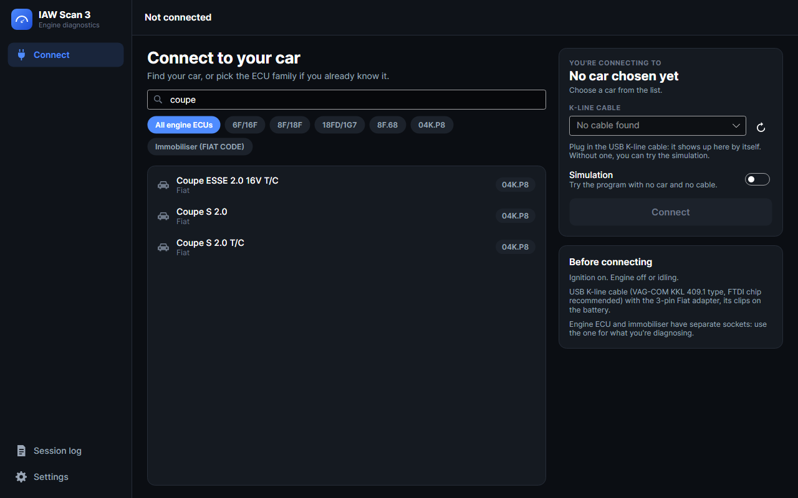
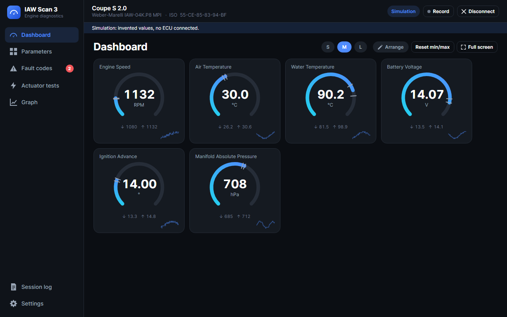
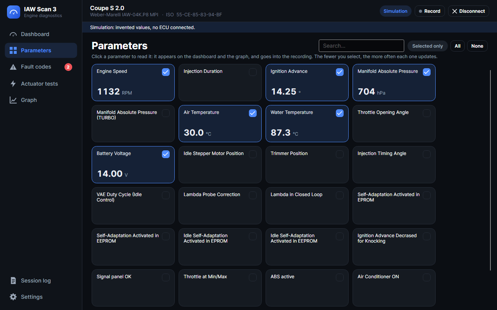
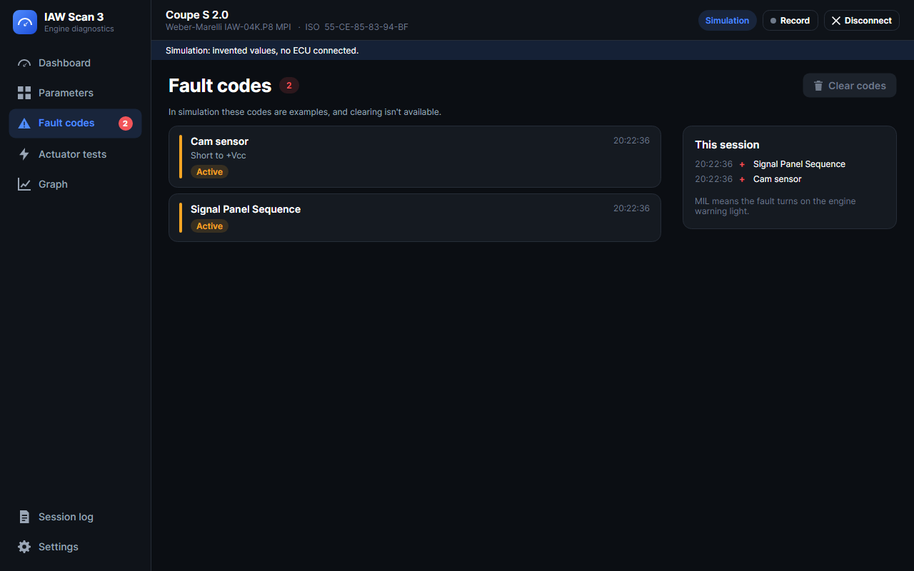
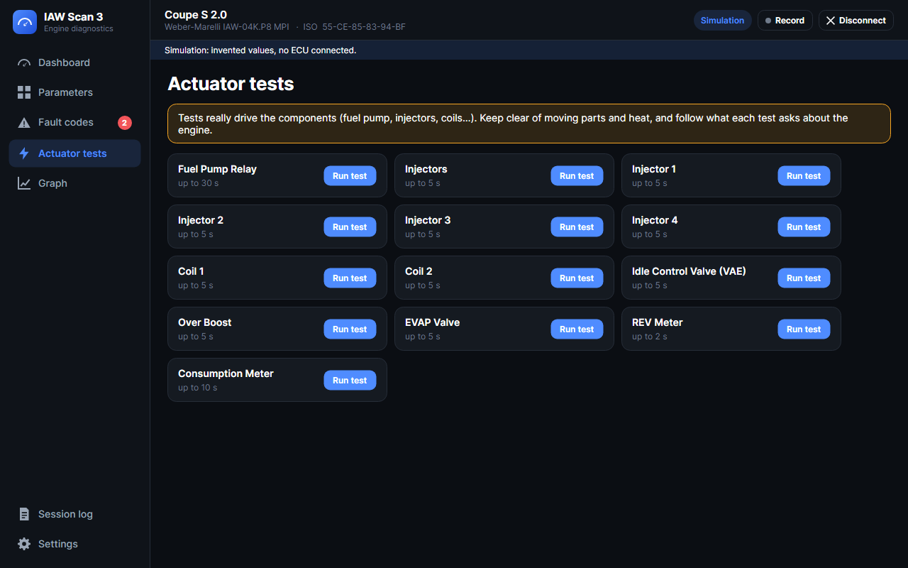
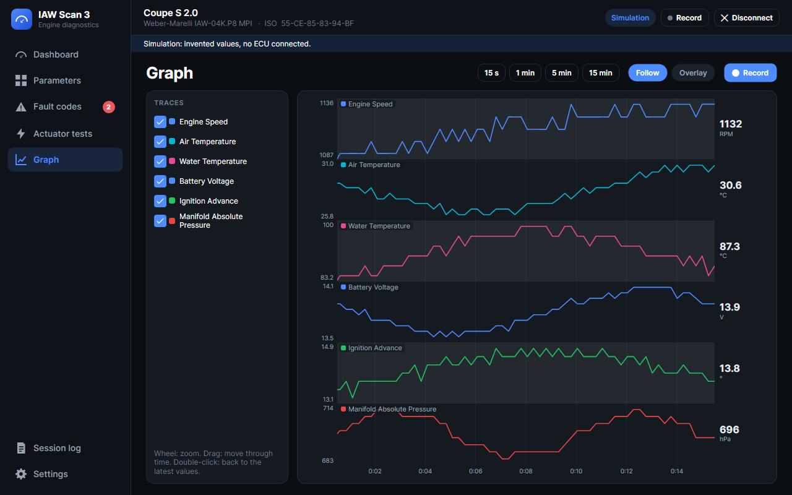
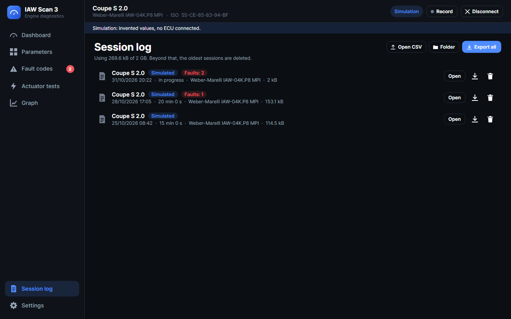
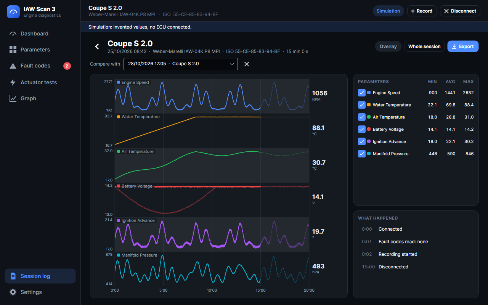

# IAW Scan 3 desktop app: user guide

How to use the desktop app once it's installed ([Windows and Linux instructions](../../README.md#install-the-desktop-app)). Everything here can be tried with no car and no cable: turn on **Simulation** on the Connect page.

> Italiano: [guida utente](guida-utente.md).

The function keys work from anywhere: **F2** Dashboard, **F3** Parameters, **F4** Fault codes, **F5** Actuator tests, **F6** Graph, **F7** Adjustments, **F8** Session log, **F9** Settings, **F10** connect or disconnect, **F11** dashboard full screen, **Esc** cancels a question or leaves full screen.

## Connect

1. **Turn the ignition on.** The engine can be off or idling.
2. **Plug in the cable:** USB K-line cable, 3-pin Fiat adapter on the diagnostic socket, its clips on the battery. Engine ECU and FIAT CODE immobiliser have separate sockets.
3. **Find your car** by typing part of its name. Words can come in any order (`coupe turbo`). If you already know the ECU family, click its chip instead. **Immobiliser (FIAT CODE)** lists the cars for the immobiliser.
4. **Check the cable** under *K-line cable*. The list updates by itself when you plug the cable in. On Windows the cable appears as `COM3` or similar, on Linux as `/dev/ttyUSB0`.
5. Click **Connect** (or press F10).

The program waits up to 10 seconds for the ECU, which announces itself when the ignition comes on. If the ignition was off, turn it on during that wait. Your choices are remembered for next time.

**If the ECU doesn't identify itself,** the program connects anyway, as the original did, and shows a warning under the status bar. Check the ignition and that the cable is on the right socket.

## Dashboard

The parameters you've chosen, as gauges. On each one:

- the **arc** shows the value on a scale that widens by itself if the value goes beyond it;
- the two **small marks** and the **↓ ↑** figures are the lowest and highest values since connecting. **Reset min/max** starts them again from now;
- the **line at the bottom** is the last minute.

Yes/no parameters appear as a label instead of a gauge. `#ERR` means the ECU gave no valid answer for that value.

- **S / M / L** changes the size of the tiles.
- **Arrange** moves tiles or removes them. Order and choice are remembered for each ECU.
- **Full screen** (F11) leaves only the gauges on screen, as large as the screen allows, for a display in the car. To leave it: Esc, F11 again, or the button in the corner.

The first time you connect to an ECU, the dashboard starts with engine speed, temperatures, battery, advance and pressure.

## Parameters

Everything the ECU can report. Click a parameter to start reading it: it joins the dashboard and the graph, and goes into the recording. Reading fewer parameters makes each one update more often, because the ECU answers one byte at a time on a slow line.

Where two parameters convert the same raw value differently (manifold pressure for naturally aspirated and turbo engines), only the one matching your engine is meaningful.

## Fault codes

Codes are read all the time, whatever page is open, so the red number in the sidebar is always current.

- **Active:** the fault is present now. **Verified:** confirmed by the ECU. **Stored:** kept in memory.
- **MIL:** the fault turns on the engine warning light. The red bar marks these.
- **This session** lists what appeared (+) and went away (−), and when.

**Clear codes** erases the codes stored in the ECU. It always asks first, and it can't be undone, but what was there stays in the session log. It isn't available in simulation.

## Actuator tests

These really drive the components: fuel pump, injectors, coils and others. Each test asks for confirmation, says whether the engine must be off or running, and stops by itself after the time shown. **Cancel** stops it sooner. Keep clear of moving parts and heat. The page only appears for ECUs that have tests.

## Graph

History of what's being read, from the moment you selected it, for up to an hour. Each parameter has its own lane with its own scale, so 6000 rpm doesn't flatten 14 V.

- **Wheel:** zoom. **Drag:** move through time. **Pointer:** reads the values at that moment. **Double-click:** back to the latest values.
- **15 s to 15 min:** how much to show. **Follow:** keep showing the latest values.
- **Overlay:** all traces in one plot, each on its own scale, to compare their shapes. The readings stay true.
- **Traces:** untick what you don't want to see.

**Record** saves the values to the session log. It's the same button as the one in the status bar.

## Session log

Every connection to a real ECU is logged: what was connected, every fault code change, tests, clearing, communication problems, and the values read if recording was on. With **Record automatically** on (the default) recording starts as soon as a real ECU connects. A simulation is only logged if you press Record.

**Open** a session to study it:

- the chart works like the live one; the right-hand table gives minimum, average and maximum;
- **Compare with** draws another session behind this one (dashed), aligned at the start;
- under **What happened**, clicking an event moves the chart to that moment.

**Open CSV** opens a recording from another computer, including the `IESexp_*.csv` files from earlier versions.

### Export, also for AI analysis

**Export** (one session) and **Export all** save a ZIP holding:

| File | Content |
|---|---|
| `README.md` | What the files are and how to read them, and an example request (in the language you're using) |
| `session.json` | ECU, vehicle, ISO and spare-part codes, start, end, columns |
| `events.jsonl` | What happened, one JSON object per line |
| `data.csv` | The values: `t_s` (seconds from the start), `utc`, then one column per parameter. Separator `;`, decimal point `.`, empty cell = no valid answer or not being read |

To open `data.csv` in Excel, use Data, From Text/CSV, and choose UTF-8 and the semicolon: opened with a double-click, accents and decimals can come out wrong.

The ZIP is meant to be readable as it is by a person, a script or an AI assistant: you can hand it over and ask for a summary and anything out of the ordinary. Remember an AI can be wrong: use its answers as ideas for what to check, not as a diagnosis. These are also what the ECU reports, so a faulty sensor makes them wrong too.

### Where the files are

- Windows: `%LOCALAPPDATA%\IAWScan3`
- Linux: `~/.local/share/IAWScan3`

Sessions are in `Sessions`, one folder each. Beyond the size limit in Settings (2 GB by default), the oldest are deleted. To keep everything somewhere else, on a USB stick for example, set the environment variable `IAWSCAN_DATA` to that folder.

## Adjustments

Only for ECUs that have them. They change values stored in the ECU, so each one asks first. Some ask for a number from 0 to 255: choose it with the slider or the − and + buttons, **Send to ECU**, then **Close**. Only use them if you know what they do.

## Settings

Language (English, Italiano, or the same as the system), theme (dark, light, or the same as the system), automatic recording, the size limit of the log, where it is, version, credits and license. Parameter and fault names come from the diagnostic engine and change language at the next connection.

## Troubleshooting

| What you see | What to check |
|---|---|
| No cable in the list | Windows: the FTDI driver (Device Manager must show a COM port). Linux: `ls /dev/ttyUSB*`, and `sudo dmesg \| tail` right after plugging it in. |
| "Can't open the port" | Close other programs using it. Linux: `sudo usermod -aG dialout $USER`, then log out and back in. |
| "The ECU didn't identify itself" or communication lost | Ignition on? Cable on the right socket? Adapter clips on the battery? Turn the ignition off and on, then **Reconnect**. |
| Values update slowly | Read fewer parameters. With an FTDI cable, set its latency timer to 1 ms: on Windows in Device Manager, port, Port Settings, Advanced. The Linux package does this by itself. |
| The program won't start on Linux | Install with `apt`, which also fetches the libraries it needs. |
